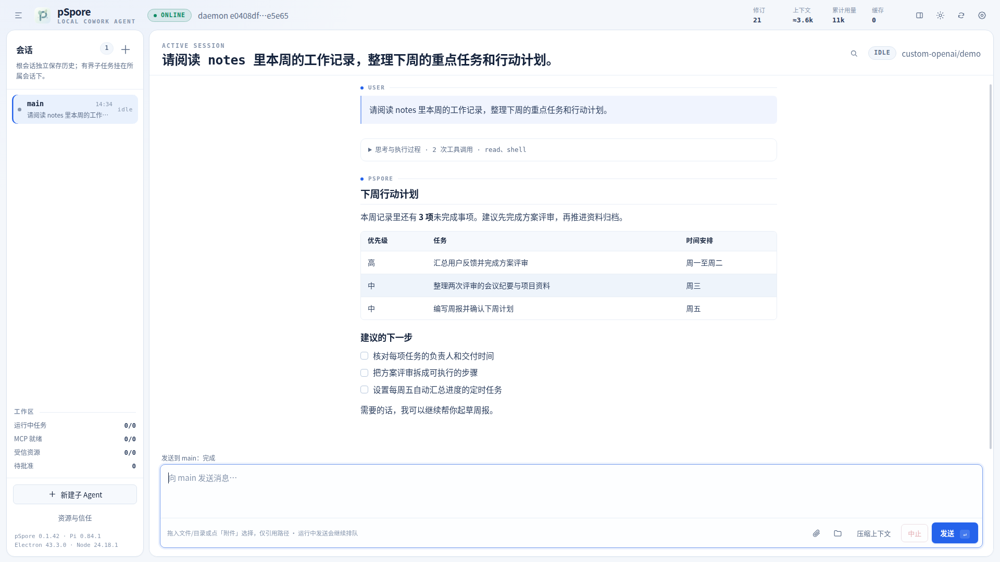
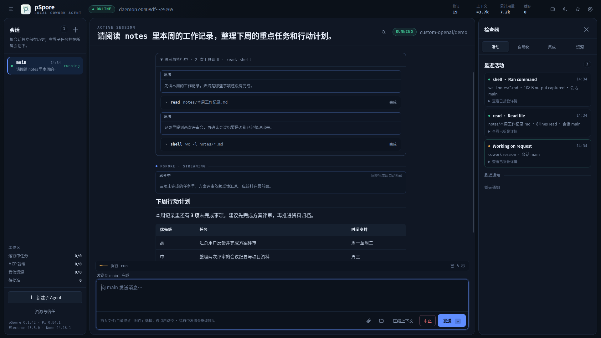
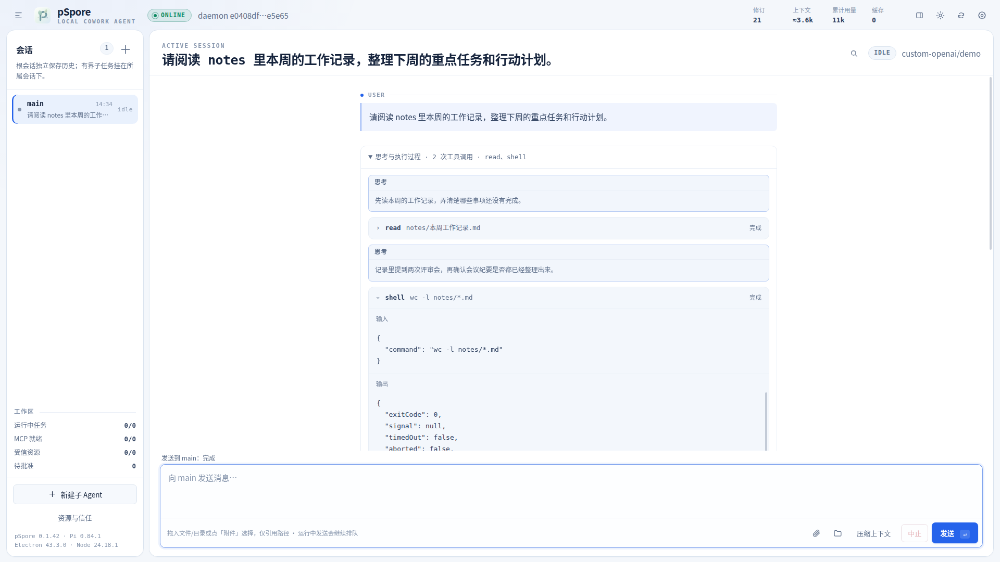

# p-spore

[English](README.md) · [简体中文](https://github.com/advnljs/pSpore/blob/main/README.zh-CN.md)

**A local-first AI agent for Linux.** pSpore runs a small background service on your own
machine. The service keeps your sessions, memory, scheduled jobs and child agents, and you
work with it from a desktop app, a terminal UI, or one-line CLI commands. Everything lives
under `~/.pspore`: there is no hosted backend and no account.

Built on [Pi](https://github.com/earendil-works/pi) (pinned to `v0.84.1`). MIT licensed.



<sub>The Linux desktop app at 1920 × 1080, showing demonstration data. More screenshots are in the [Desktop app](#desktop-app) section.</sub>

## Highlights

- **Keeps working after you close the window.** Sessions, scheduled jobs and child agents run in a
  per-user systemd service. The desktop app and the TUI are clients that reconnect to it.
- **Reads your files.** Plain text, Word, Excel, PowerPoint and PDF are turned into text the agent
  can quote and summarize. Text is decoded as UTF-8, UTF-16 or GB18030.
- **Shows its work.** Each tool call shows its name, input and output. When a run finishes, its
  steps fold into one line and the answer stays in view.
- **Writes long documents** in a side panel, with versions, a diff against the previous version,
  and export to TXT, Markdown, DOCX and PDF.
- **Asks before risky actions.** One approval policy covers file edits, shell commands, `sudo`
  and MCP calls.
- **Works with your own model.** It supports DeepSeek, OpenAI, and any OpenAI-compatible endpoint
  that speaks Chat Completions or Responses.

## Contents

- [Quick start](#quick-start)
- [Desktop app](#desktop-app)
- [Configure a model](#configure-a-model)
- [Approvals](#approvals)
- [Everyday use](#everyday-use)
- [Automation and extensions](#automation-and-extensions)
- [Where your data lives](#where-your-data-lives)
- [Security model](#security-model)
- [Development](#development)

## Quick start

You need:

- Linux, x86_64 or ARM64
- Node.js 24 (`>=24.0.0 <25`)
- systemd user services (`systemctl --user`). WSL and minimal containers have to enable these first.
- Optional: `ripgrep`, which file search uses. Run `p-spore doctor` to check your setup.

```bash
npm install --global p-spore   # installs the `p-spore` and `pspore` commands
p-spore setup                  # pick a provider and model, then enter the API key
p-spore tui                    # open the terminal client
```

`p-spore` and `pspore` are the same program, so use whichever you prefer. To look around
without installing anything, run `npx p-spore --help`.

The first `p-spore tui` creates `~/.pspore` and installs, enables and starts the `pSpore` user
service. It also tries to enable user lingering, so the service can start at boot without an
interactive login. Leaving the TUI does not stop the service.

Once the service is running (the TUI starts it, or run `p-spore service install`), you can
also send a task without opening a client:

```bash
p-spore prompt "summarize the notes in ~/notes/this-week.md"
```

## Desktop app

The npm package is the CLI only and does not include Electron. To get the desktop app, download
the **full** ZIP for your architecture from
[GitHub Releases](https://github.com/advnljs/pSpore/releases/latest):

| Machine | Asset name contains |
|---|---|
| x86_64 / AMD64 | `linux-x64` |
| ARM64 / AArch64 | `linux-arm64` |

1. Extract the full ZIP. It includes the Electron/Chromium runtime.
2. Run `创建桌面快捷方式.sh` ("create desktop shortcut") once. It installs the desktop and menu
   entry and the icon.
3. Launch pSpore from the desktop or the application menu. To keep it in the taskbar, right-click
   its icon and choose **Pin to taskbar** or **Add to favorites** (the wording depends on your
   desktop).

Launching it a second time brings the open window to the front. While the workspace loads, a
small startup window appears, and you can close it with its × button or Escape.

**Upgrading.** Later versions also ship a smaller *overlay* ZIP. Run its
`./覆盖升级.sh /path/to/install` ("overlay upgrade"). It checks that the installed runtime and
architecture match, replaces the application files, keeps a rollback copy, and leaves
`~/.pspore` alone. If the runtime does not match, it stops and asks you to use the full ZIP.
Every release asset comes with a SHA-256 checksum, and published releases are never replaced.



The desktop app uses the same service as the TUI. It also adds a few things of its own:

- **Tool steps you can open.** While a run is in progress, its thinking and tool calls stay
  open. When it finishes they fold into one summary line, and you can open them again whenever
  you like.

  

- **File references by drag and drop.** Drop files or folders onto the message box to reference
  them. Dropping records only the absolute path: nothing is read, uploaded or sent until you send
  the message.
- **Clickable local paths.** Absolute paths and `file://` links in a reply open with a click. The
  folder icon next to a path shows the file in your file manager. The app checks first that the
  target exists and is a regular, non-executable file or a directory.
- **Search the current session** with <kbd>Ctrl</kbd>+<kbd>F</kbd>. The search also finds text
  inside folded tool steps.

## Configure a model

No model is configured out of the box. The service still starts, so you can check its health,
but prompts return `model_not_configured` until you set one up. The quickest way is the guided
`p-spore setup` (also `/config wizard` in the TUI, or the **Settings** button in the desktop app).
You can also configure everything directly:

```bash
p-spore config show                                     # current settings, secrets hidden
p-spore config set deepseek deepseek-v4-flash off       # provider, model, thinking level
p-spore config set openai gpt-5.6-terra low
p-spore config set custom-openai my-model https://gateway.example.com/v1 responses off
p-spore config key                                      # hidden input, or piped from stdin
p-spore service restart                                 # apply to a running service
```

| Provider | Use it for |
|---|---|
| `deepseek` | DeepSeek's API |
| `openai` | OpenAI's API |
| `custom-openai` | Any OpenAI-compatible endpoint. Choose `chat` or `responses` compatibility. |

API keys are written to `~/.pspore/credentials/<provider>.api-key` with mode `0600`. They are never
stored in `config.json`, sessions or logs. If your model sits behind a proxy, `config cookie` stores an
optional `Cookie` header in the same way, and `config header NAME` stores any other request header.
Use `config clear-key`, `config clear-cookie` and `config clear-header NAME` to remove them.

**Automatic context compaction** is on by default. When a conversation gets long, older turns are
summarized so that the run can continue.

```bash
p-spore config compact on 16384 20000 100000   # RESERVE  KEEP  TRIGGER  (tokens)
```

- `TRIGGER` compacts once the current context reaches this many tokens.
- `RESERVE` compacts when the context comes within this many tokens of the model's limit.
- `KEEP` sets how many recent tokens stay verbatim after compaction.

Compaction runs as soon as either `TRIGGER` or `RESERVE` is reached. The same settings are under
**Settings** in the desktop app and `/config compact` in the TUI.

## Approvals

One service-wide policy decides which tool calls need your approval:

| Mode | Behaviour |
|---|---|
| `ask_risky` *(default)* | Asks only before operations that look risky |
| `ask_all` | Asks before every tool call that changes something |
| `allow_all` (alias `bypass`) | Never asks. Reads, writes, shell, `sudo` and MCP calls run immediately. |
| `deny` | Refuses every tool call that changes something |

```bash
p-spore config permissions ask_risky
p-spore service restart
```

The same setting is `/config permissions MODE` in the TUI and **Settings → 权限** in the desktop app.
A running service picks up the change after a restart. pSpore is not a sandbox, so turn approvals
off only for work you already trust.

## Everyday use

```bash
p-spore status                     # service and session status
p-spore doctor                     # check Node, config, model, shell, ripgrep, MCP and the service
p-spore sessions                   # list sessions
p-spore session new "Research"     # create a session
p-spore prompt --session ID "..."  # send to a specific session
p-spore session delete ID          # delete a session and its transcript
p-spore service logs               # recent service log
p-spore service restart            # restart the background service
p-spore help                       # every command
```

- **Sessions** are saved and restored when the service restarts. Create one with `＋` in the desktop
  app, or with `/new [TITLE]` and `/select ID` in the TUI.
- **Messages sent while a session is busy** wait in a queue, marked `继续排队` ("queued"). Choose
  `直接发送消息` ("send now") in the desktop app or `/send-now N` in the TUI to send one at the next
  safe point instead of waiting.
- **Documents.** The built-in `document` tool reads `.docx`/`.doc`, `.xlsx`/`.xls`, `.pptx`/`.ppt`,
  PDF and text files. It recognizes the format from the file's contents, so a renamed file still
  works. WPS's own `.wps`/`.et`/`.dps` formats are not supported, so save those as `.docx`, `.xlsx` or
  `.pptx` first. A scanned PDF contains images rather than text and comes back empty.
- **Another home directory.** Add `--home PATH` to any command, or set `PSPORE_HOME`, to use a
  directory other than `~/.pspore`.

## Automation and extensions

### Scheduled jobs

A job is a five-field cron definition in `workspace/jobs/<job-id>.json`. Every run is recorded,
and you can trigger or cancel a run yourself. There is an example in
[`examples/jobs/heartbeat.json`](examples/jobs/heartbeat.json).

```bash
p-spore schedule put job.json      # create or update a job from a file
p-spore jobs                       # loaded jobs
p-spore run <job-id>               # run one now and wait
p-spore runs                       # run history
p-spore cancel <run-id>
p-spore notifications
```

### Child agents

A child agent works on one bounded task, with its own budget and read access shared with its
parent. You can message it while it works, wait for it, or cancel it along with any agents it
started.

```bash
p-spore agent spawn "inspect the workspace API"
p-spore agent send <agent-id> "focus on error handling"
p-spore agents
p-spore agent join <agent-id>
p-spore agent cancel <agent-id>
```

### MCP servers

MCP servers are declared in `config.json`. Secrets are referenced indirectly through
`envRefs`/`headerRefs`, so they never appear in the file itself. Only servers marked `trusted-local`
are started, and only when they are first needed.

```bash
p-spore mcp list                   # configured servers and health, without connecting
p-spore mcp discover <server-id>   # connect and activate one trusted server
p-spore mcp tools                  # tools active in this service process
p-spore mcp ping <server-id>
```

### Skills and plugins

Put your own skills in `~/.pspore/workspace/skills/`. Each skill is a directory with a `SKILL.md`,
and nested suites such as `office/excel/SKILL.md` work too. Skills are available in every new
session. Adding a `name` and `description` in the frontmatter is recommended. Only the name,
description and path go into the prompt, and the model reads the rest when it needs to. When the
model edits a file in this directory, it asks first, because these instructions shape every later
session.

```bash
p-spore skills    # every skill, and why any one of them is not loaded
```

Host plugins, and skills that you want pinned to an exact content digest, go through a staging
directory instead. Staged content is inspected without being run (schema, paths, dependencies and
syntax only). To install it, you repeat the exact SHA-256 that the inspection showed you.

```bash
p-spore resource inspect <staging-path>
p-spore resource install <staging-path> <sha256>
p-spore resources
p-spore resource disable <skill|host-plugin> <name> <sha256>
```

## Where your data lives

| Path under `~/.pspore` | Contents |
|---|---|
| `config.json` | All settings. The desktop Settings dialog edits this file too. |
| `credentials/` | API keys, cookies and headers, each in a `0600` file |
| `workspace/` | Your skills, jobs and staging area |
| `state/` | Sessions and their transcripts, runs, approvals, notifications and audit records |
| `run/` | The local socket that clients use to talk to the service |

## Security model

- **Single user, local only.** pSpore opens no network ports. Clients reach the service through a Unix
  domain socket. If you use a remote model, your conversation is sent to that model provider.
- **Not a sandbox.** Tools run as the user who started pSpore. With `allow_all`, the model can do
  anything that user can do, including reaching root through passwordless or cached `sudo`.
- **Code is trusted explicitly.** Pi extensions, host plugins and local MCP servers load only after
  you trust them. Skills in `workspace/skills/` count as trusted because you put them there. The model
  needs approval to edit that directory, but a shell command can still get around that check.
- **The desktop app is locked down.** The window has no Node.js or file system access and cannot
  navigate to other sites, open new windows, download files or make network requests. Every
  privileged action goes through a fixed, validated channel to the main process.

## Development

```bash
git clone https://github.com/advnljs/pSpore.git
cd pSpore
npm install
npm run check          # strict typecheck, all tests, production build
npm run desktop        # build, then open the Electron app
npm run test:electron  # desktop end-to-end checks on Linux (needs xvfb-run)
```

The developer guide (in Chinese) is [docs/project-overview.md](docs/project-overview.md). It covers the
architecture, source layout, tests and the release process. The full design is in
[docs/detailed-design.md](docs/detailed-design.md).

- [Repository](https://github.com/advnljs/pSpore) · [Issues](https://github.com/advnljs/pSpore/issues) · [Releases](https://github.com/advnljs/pSpore/releases)

## License

[MIT](LICENSE). Third-party dependencies keep their own licenses.
