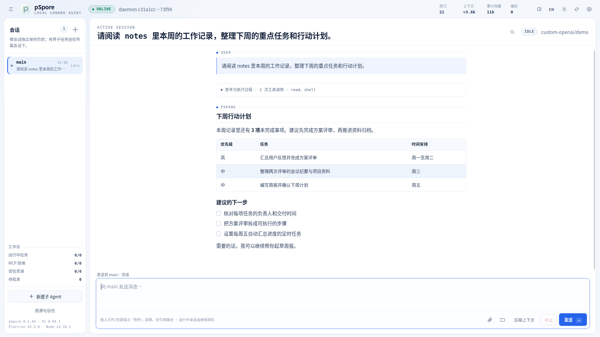
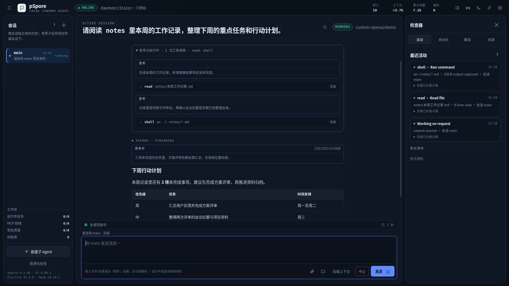
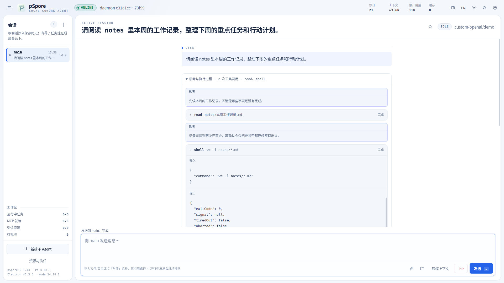
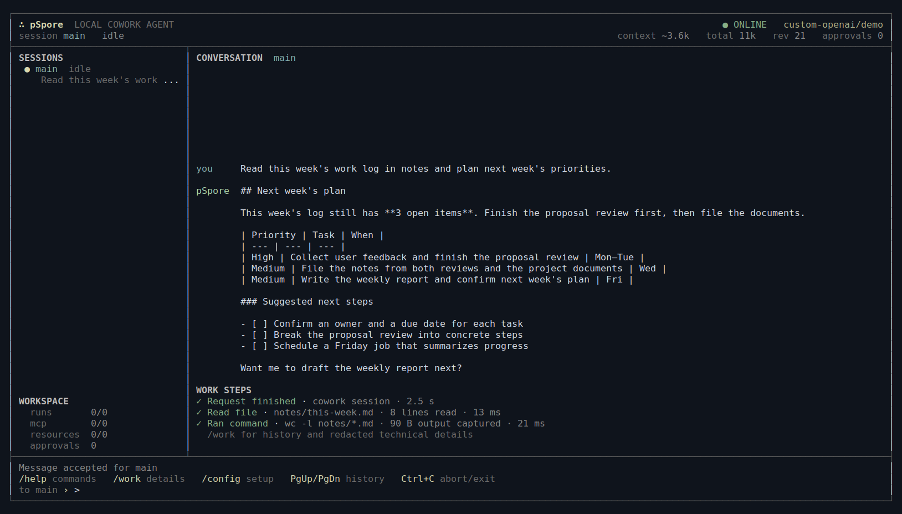

# p-spore

[English](README.md) · 简体中文

**面向 Linux 的本地 AI 工作助手。** pSpore 在你自己的电脑上运行一个后台服务，由它保存会话、长期记忆、定时任务和子 Agent；你可以通过桌面 GUI、终端 TUI 或一行 CLI 命令使用它。所有数据都在 `~/.pspore`，没有托管后端，也不需要注册账号。

项目基于 [Pi](https://github.com/earendil-works/pi)（锁定 `v0.84.1`），采用 [MIT 许可证](LICENSE)开源。

**pSpore 非常适合用于信创 PC**：面向 Linux 桌面办公，提供 x86_64 和 ARM64 发行包，ARM64 构建以银河麒麟 V10、飞腾平台的 glibc 2.31 环境为适配目标。可连接自建的 OpenAI 兼容模型服务，处理本机文档、文件和日常工作任务。



<sub>截图来自实际运行的桌面客户端，使用演示数据，分辨率 1920 × 1080。更多截图见[桌面版](#桌面版)和[终端界面](#终端界面tui)两节。</sub>

## 主要功能

- **关掉窗口，任务照常进行**：会话、定时任务和子 Agent 都运行在用户级 systemd 服务里；桌面版和 TUI 只是可以随时重连的客户端。
- **读懂本机文件**：支持纯文本、Word、Excel、PowerPoint 和 PDF；文本按 UTF-8、UTF-16 或 GB18030 自动解码。
- **过程看得见**：每次工具调用都显示名称、输入和输出；任务结束后，过程自动折叠成一行，最终回复保持在视线内。
- **长文写作**：独立文稿面板，支持流式正文、多版本、与上一版对照，导出 TXT、Markdown、DOCX、PDF。
- **高风险操作先问你**：改文件、执行命令、`sudo`、MCP 调用统一经过审批策略。
- **使用你自己的模型**：支持 DeepSeek、OpenAI，以及任何兼容 Chat Completions 或 Responses 协议的 OpenAI 兼容端点。

## 目录

- [桌面版](#桌面版)
- [终端版快速开始](#终端版快速开始)
- [终端界面（TUI）](#终端界面tui)
- [配置模型](#配置模型)
- [审批策略](#审批策略)
- [日常使用](#日常使用)
- [自动化与扩展](#自动化与扩展)
- [数据存放位置](#数据存放位置)
- [安全边界](#安全边界)
- [参与开发](#参与开发)

## 桌面版

在 [GitHub Releases](https://github.com/advnljs/pSpore/releases/latest) 下载与机器架构匹配的**完整**桌面 ZIP：

| 机器架构 | 文件名中的架构标识 |
|---|---|
| x86_64 / AMD64 | `linux-x64` |
| ARM64 / AArch64（如飞腾平台） | `linux-arm64` |

1. 解压完整 ZIP，其中已带 Electron/Chromium 运行时。
2. 运行一次 `创建桌面快捷方式.sh`，安装桌面图标和应用菜单入口。
3. 从桌面或应用菜单启动 pSpore。想固定到任务栏时，右键任务栏图标，选择「固定到任务栏」或「加入收藏」（不同桌面环境的叫法略有不同）。

再次启动会把已打开的窗口带到前台。工作区加载期间会先显示一个启动小窗，可以点 × 或按 Esc 取消。

**升级**：之后的版本还会提供体积更小的 overlay 升级包，运行其中的 `./覆盖升级.sh /原安装目录` 即可。升级程序会先检查运行时和架构是否匹配，再替换应用文件并保留回滚备份；`~/.pspore` 中的数据不受影响。运行时不匹配时会停止并提示改用完整包。每个版本的下载资产都附有 SHA-256 校验文件，已发布的版本不会被覆盖。



桌面版与 TUI 使用同一个后台服务，另外提供：

- **中英文界面**：默认跟随系统语言；点顶栏的 **EN** / **中** 按钮即可切换，选择会被记住。

- **可展开的执行过程**：运行中，思考与工具调用保持展开；完成后折叠为一行摘要，随时可以再展开查看输入和输出。

  

- **拖入文件作为引用**：把文件或文件夹拖进输入框即可引用。拖入时只记录绝对路径，不会读取、上传或自动发送，直到你点发送。
- **点击打开本地路径**：回复里的绝对路径和 `file://` 链接可以直接点开；路径后面的文件夹图标会在文件管理器中定位该文件。打开前会检查目标存在，并且是普通的非可执行文件或目录。
- **搜索当前会话**：按 <kbd>Ctrl</kbd>+<kbd>F</kbd>，也能搜到已折叠的工具过程里的内容。
- **文稿分屏**：文稿面板与对话左右分屏，分隔线可以拖动。

## 终端版快速开始

需要：

- Linux（x86_64 或 ARM64）
- **Node.js 24**（`>=24.0.0 <25`）
- 可用的 systemd 用户服务（`systemctl --user`）；WSL 或精简容器需要先启用
- 可选：`ripgrep`（文件搜索使用）。可以用 `p-spore doctor` 检查环境。

```bash
npm install --global p-spore   # 安装 p-spore 和 pspore 两个等价命令
p-spore setup                  # 引导选择模型服务、模型并输入 API Key
p-spore tui                    # 打开终端客户端
```

只想先看看用法，可以不安装直接运行 `npx p-spore --help`。

首次运行 `p-spore tui` 会创建 `~/.pspore`，并安装、启用、启动用户级 `pSpore` 服务，同时尽量开启 linger，让服务开机即可启动、无需先登录桌面。退出 TUI 不会停止服务。

服务运行后（启动过 TUI，或执行过 `p-spore service install`），也可以不打开任何客户端，直接提交任务：

```bash
p-spore prompt "整理 ~/notes/本周记录.md 里的待办"
```

> npm 包只有 CLI/TUI，**不包含 Electron 运行时**。需要图形界面请下载上面的完整桌面 ZIP。

## 终端界面（TUI）

`p-spore tui` 打开一个全屏的终端客户端，连接同一个后台服务。服务重启后会自动重连；退出 TUI 不会中断正在运行的任务。TUI 的界面文字为英文。



- **布局**：左侧是会话列表和工作区状态，中间是对话，下方列出本轮的工作步骤，最底部是输入行。终端宽度不足 104 列时自动改为单栏。
- **发送**：输入消息后按 Enter，发给当前选中的会话。会话忙碌时，新消息会进入队列；`/send-now N` 让第 N 条排队消息在下一个安全时机发出。
- **按键**：PgUp/PgDn 翻看历史，Esc 或 `/back` 关闭面板，Ctrl+C 中止正在运行的任务；没有任务运行时，连按两次 Ctrl+C 退出。

| 命令 | 作用 |
|---|---|
| `/help` | 列出全部命令 |
| `/new [标题]` · `/select ID` · `/delete [ID]` | 新建、切换或删除会话 |
| `/abort` · `/compact` | 中止当前任务 · 立即压缩上下文 |
| `/work [步骤ID]` | 工作历史，或某一步脱敏后的详情 |
| `/config` · `/config wizard` | 查看模型设置 · 运行设置向导 |
| `/approve [ID] [once\|session\|job]` · `/deny [ID]` | 回应审批请求 |
| `/agents` · `/jobs` · `/runs` · `/skills` · `/mcp` | 子 Agent、定时任务、执行记录、Skills 与 MCP |
| `/quit` | 退出 TUI，后台服务继续运行 |

## 配置模型

默认没有配置模型。后台服务仍会正常启动，方便检查状态，但在配置模型之前发出的任务会返回 `model_not_configured`。

最简单的方式是运行引导式的 `p-spore setup`；也可以在 TUI 中输入 `/config wizard`，或在桌面版右上角点「设置」。直接用命令配置也可以：

```bash
p-spore config show                                     # 查看当前设置（不显示密钥）
p-spore config set deepseek deepseek-v4-flash off       # 服务商、模型、思考强度
p-spore config set custom-openai my-model https://gateway.example.com/v1 chat off
p-spore config key                                      # 隐藏输入 API Key，也可从 stdin 读取
p-spore service restart                                 # 让运行中的服务应用新设置
```

| 服务商 | 适用场景 |
|---|---|
| `deepseek` | DeepSeek 官方 API |
| `openai` | OpenAI 官方 API |
| `custom-openai` | 任意 OpenAI 兼容端点，例如自建模型网关；可选 `chat` 或 `responses` 协议 |

API Key 保存在 `~/.pspore/credentials/<服务商>.api-key`（权限 `0600`），不会写入 `config.json`、会话或日志，也不要放进命令参数、项目文件或 Git。模型服务需要代理认证时，可用 `config cookie` 以同样的方式保存 Cookie，或用 `config header 名称` 保存其他请求头；对应的 `config clear-key`、`config clear-cookie`、`config clear-header 名称` 用于删除。

**自动压缩上下文**默认开启：对话变长时，较早的内容会被总结，任务可以继续进行。

```bash
p-spore config compact on 16384 20000 100000   # 预留  保留  触发（单位：token）
```

- **触发**：当前上下文达到这个长度就压缩。
- **预留**：距离模型上限只剩这么多 token 时也会压缩。
- **保留**：压缩后原样保留的近期内容长度。

两个条件先到哪个就按哪个触发。桌面版「设置」和 TUI 的 `/config compact` 中有相同选项。界面上「上下文」显示当前上下文长度，「累计用量」显示整个会话消耗的 token，两者分开统计。

## 审批策略

整个服务使用同一套审批策略：

| 模式 | 行为 |
|---|---|
| `ask_risky`（默认） | 只在看起来有风险的操作前请求批准 |
| `ask_all` | 每个会修改内容的工具调用都请求批准 |
| `allow_all`（别名 `bypass`） | 从不询问：读写、命令、`sudo`、MCP 调用直接执行 |
| `deny` | 拒绝所有会修改内容的工具调用 |

```bash
p-spore config permissions ask_risky
p-spore service restart
```

TUI 中用 `/config permissions 模式`，桌面版在「设置 → 权限」。修改后需要重启服务才会生效（桌面版自己启动的服务会自动重启）。pSpore 不是沙箱，只在你信任的工作环境里关闭审批。

## 日常使用

```bash
p-spore status                       # 服务与会话状态
p-spore doctor                       # 检查 Node、配置、模型、Shell、ripgrep、MCP 与服务
p-spore sessions                     # 会话列表
p-spore session new "工作计划"        # 新建会话
p-spore prompt --session ID "..."    # 发给指定会话
p-spore session delete ID            # 删除会话及其记录
p-spore service logs                 # 服务日志
p-spore service restart              # 重启后台服务
p-spore help                         # 全部命令
```

- **会话**会持久保存，服务重启后自动恢复。桌面版点「＋」新建；TUI 用 `/new [标题]` 新建、`/select ID` 切换。
- **会话忙碌时发送的消息**会自动排队，显示为「继续排队」；点「直接发送消息」（TUI 中 `/send-now N`）可以让它在下一个安全时机插入，而不必等任务结束。
- **文档读取**：内置 `document` 工具支持 `.docx`/`.doc`、`.xlsx`/`.xls`、`.pptx`/`.ppt`、PDF 和纯文本，并按文件内容而不是扩展名判断格式，改过扩展名也能读。WPS 私有的 `.wps`、`.et`、`.dps` 不支持，请先另存为标准 Office 格式；扫描版 PDF 只有图片，需要先做 OCR。
- **使用其他数据目录**：任何命令加 `--home 路径`，或设置环境变量 `PSPORE_HOME`。

## 自动化与扩展

### 定时任务

在 `workspace/jobs/<任务ID>.json` 中用五段式 cron 定义任务，示例见 [`examples/jobs/heartbeat.json`](examples/jobs/heartbeat.json)。每次执行都有记录，也可以手动触发或取消。

```bash
p-spore schedule put job.json      # 从文件创建或更新任务
p-spore jobs                       # 已加载的任务
p-spore run <任务ID>                # 立即执行一次并等待完成
p-spore runs                       # 执行记录
p-spore cancel <执行ID>
p-spore notifications              # 通知
```

### 子 Agent

子 Agent 独立处理一项有边界的任务，拥有自己的预算，并与上级共享读取权限。运行中可以给它发消息、等待它完成，或连同它派生的子 Agent 一起取消。

```bash
p-spore agent spawn "检查工作区的 API"
p-spore agent send <agent-id> "重点看错误处理"
p-spore agents
p-spore agent join <agent-id>
p-spore agent cancel <agent-id>
```

### MCP 服务

MCP 服务在 `config.json` 中声明，凭据通过 `envRefs`/`headerRefs` 间接引用，不直接写进配置文件。只有标记为 `trusted-local` 的服务会启动，而且只在第一次用到时才连接。

```bash
p-spore mcp list                   # 已配置的服务及状态（不会主动连接）
p-spore mcp discover <server-id>   # 连接并启用一个受信服务
p-spore mcp tools                  # 当前服务进程中可用的工具
p-spore mcp ping <server-id>
```

### Skills 与插件

自己的 Skill 放在 `~/.pspore/workspace/skills/`：每个 Skill 是一个带 `SKILL.md` 的目录，也支持 `office/excel/SKILL.md` 这样的嵌套结构，新会话即可使用。建议在 frontmatter 中写好 `name` 和 `description`。提示词里只放名称、描述和路径，模型需要时再读取全文。模型修改这个目录里的文件前会先请求批准，因为这些说明会影响之后的每个会话。

```bash
p-spore skills    # 列出所有 Skill，以及未加载的原因
```

Host 插件，以及需要按内容摘要固定版本的 Skill，要先放进 staging 目录：检查只看结构、路径、依赖和语法，不会执行其中的代码；安装时必须回填检查时显示的 SHA-256。

```bash
p-spore resource inspect <staging-path>
p-spore resource install <staging-path> <sha256>
p-spore resources
p-spore resource disable <skill|host-plugin> <name> <sha256>
```

## 数据存放位置

| `~/.pspore` 下的路径 | 内容 |
|---|---|
| `config.json` | 全部设置；桌面版「设置」修改的也是这个文件 |
| `credentials/` | API Key、Cookie 和请求头，每项一个 `0600` 私有文件 |
| `workspace/` | 你的 Skills、定时任务和 staging 目录 |
| `state/` | 会话及其记录、执行记录、审批、通知与审计 |
| `run/` | 客户端连接后台服务使用的本机 socket |

## 安全边界

- **单用户、仅本机**：pSpore 不监听任何网络端口，客户端通过 Unix domain socket 连接服务。使用远端模型时，对话内容会发送给所配置的模型服务。
- **不是沙箱**：工具以启动 pSpore 的用户身份运行。`allow_all` 意味着模型可以做该用户能做的任何事；如果有免密或已缓存的 `sudo`，影响可能扩大到 root。
- **代码需要显式信任**：Pi 扩展、Host 插件和本地 MCP 服务只有在你信任后才会加载。`workspace/skills/` 中的 Skill 由你自己放入，视为已信任；模型修改该目录需要审批，但 Shell 命令仍可能绕过这项检查。
- **桌面窗口权限受限**：页面没有 Node.js 和文件系统权限，不能跳转外部网站、打开新窗口、下载或发起网络请求；所有需要权限的操作都经由固定且经过校验的通道交给主进程处理。

## 参与开发

```bash
git clone https://github.com/advnljs/pSpore.git
cd pSpore
npm install
npm run check          # 严格类型检查、全部测试、生产构建
npm run desktop        # 构建并打开 Electron 桌面版
npm run test:electron  # Linux 桌面端到端检查（需要 xvfb-run）
```

- [开发者指南](docs/project-overview.md)：架构、目录结构、测试与发布流程
- [详细设计](docs/detailed-design.md)：完整设计与 v1 验收契约
- [源码仓库](https://github.com/advnljs/pSpore) · [桌面版下载](https://github.com/advnljs/pSpore/releases) · [npm 包](https://www.npmjs.com/package/p-spore) · [问题反馈](https://github.com/advnljs/pSpore/issues)

本项目采用 [MIT 许可证](LICENSE)。第三方依赖遵循各自的许可证。
