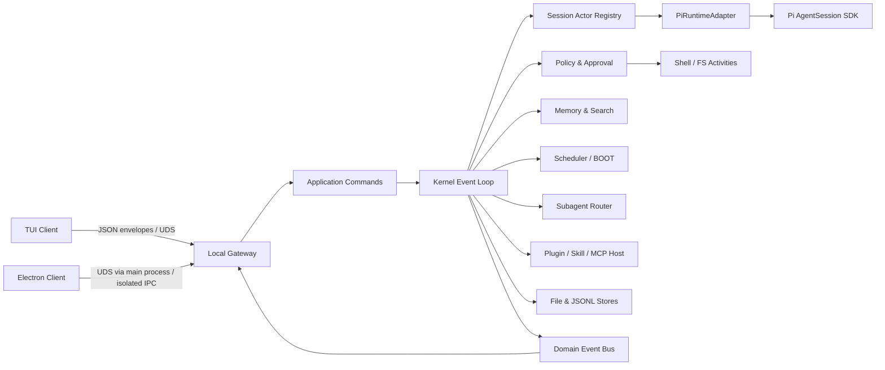
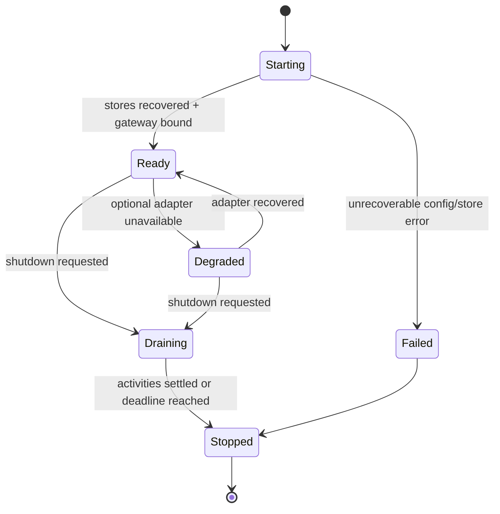
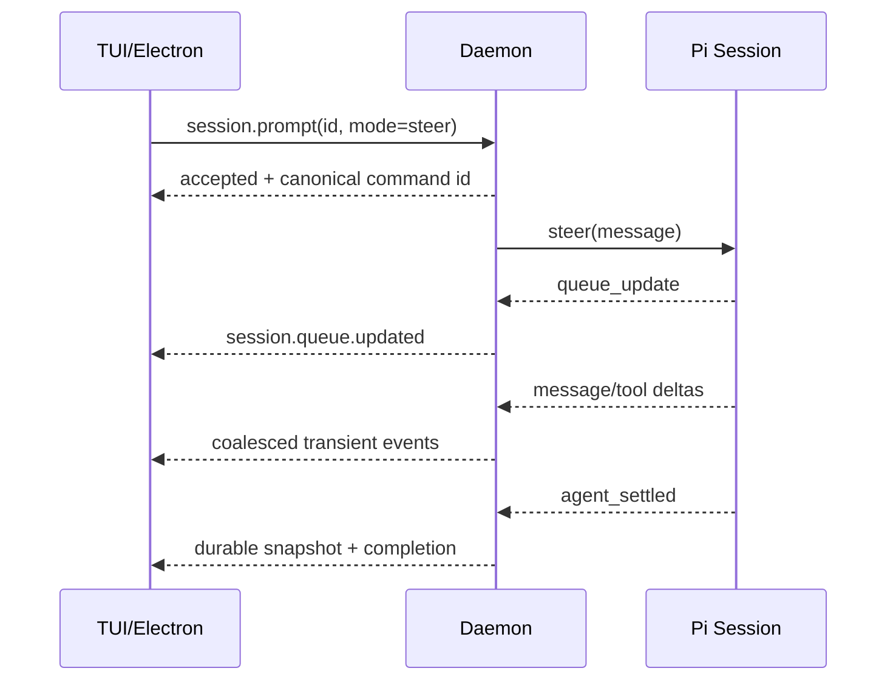

# pSpore 详细设计

> 状态：v1 Implemented / Phase 0—4 verified<br>
> 版本：0.2<br>
> 日期：2026-08-09（Asia/Shanghai）<br>
> 适用范围：Linux、本地单用户、Pi `v0.84.1` 基线

## 1. 文档目标

本文把 [initial_design.txt](../initial_design.txt) 的 11 条核心想法收敛为可实施、可测试、可演进的详细设计。它定义系统边界、运行时模型、模块接口、数据格式、安全语义、失败恢复、测试基准与分阶段交付标准。

实现已经开始。本文中的类型和命令仍是总体设计契约；只有在 `src/`、测试或实际 package scripts 中落地的部分才视为已实现。实现偏离必须以 ADR 或更新本文的方式记录原因。

### 1.1 已确认的产品假设

- 产品名为 `pSpore`。
- 它是个人本地 Agent，不是云端多租户平台。
- 首版仅支持 Linux，使用启动它的用户 UID/GID 和主机权限。
- TUI 与 Electron UI 都只是客户端；Daemon 是会话和状态的唯一写入者。
- 主动性来自明确触发器，而不是无限自唤醒：首版触发器为用户消息、启动任务、cron 和内部恢复事件。
- 默认不实现向量数据库；检索以固定记忆文件、精确搜索和 BM25 为主。
- 模型供应商、具体模型和凭据由用户配置，设计不绑定某一家模型 API。
- 首次运行由 `pspore init` 创建缺失目录、最小模板与 config；已有文件一律不覆盖。Daemon 发现未初始化目录时给出命令并退出，不暗中生成可能影响行为的规则。

## 2. 对原始构想的修正

| 原始方向 | 修正后的工程含义 | 原因 |
|---|---|---|
| 只有一个 main loop | 只有一个**顶层状态归并循环**；Pi 内部仍管理 LLM/tool turn loop，Shell、MCP、索引和 subagent 是异步活动 | 真正只有一个物理循环会阻塞实时输入、审批和并发任务 |
| 基于 Pi | 主会话使用 `@earendil-works/pi-coding-agent` SDK；不 fork Pi 的 loop，不复制 compaction/session 逻辑 | Pi 已提供 `AgentSession`、JSONL 会话、事件流、`steer/followUp`、skills 和 extensions |
| TUI/Electron 同一底层 | 共享 Daemon、应用命令、领域事件、快照和协议；不强求共享 UI 组件 | 终端渲染与 DOM 渲染模型不同，强行共享组件会增加耦合 |
| 与登录用户完全相同 | 权限可相同，环境只能做到可说明的近似：前台继承环境或通过用户默认 login shell 加载 | systemd user service 与交互式终端环境、alias/function、TTY 状态天然不同 |
| 高危操作再询问 | 使用统一 capability policy；Shell 风险识别只是启发式，默认 `ask_risky`，安全敏感场景可切 `ask_all` | 任意 Shell 文本可以混淆，单靠正则无法构成安全边界 |
| 完全放权 | `allow_all` 明确定义为当前用户级任意代码执行授权；不等于沙箱，也不绕过 OS 权限 | 防止用户把“无弹窗”误解成“仍有系统保护” |
| grep + BM25 是记忆 | 两者是词法召回，不保证语义召回；返回带来源的短片段，再按需读取原文 | 避免把 BM25 宣称为向量搜索替代品 |
| BOOT.md 生命周期 | Daemon 先 ready，再异步执行启动任务；每次 Daemon 实例、每个 workspace 至多一次，带预算、超时和审计 | 启动 Agent 不应阻塞 UI 和健康检查，任务还必须可取消和可追踪 |
| cron job | 计划触发可去重，但外部副作用不承诺 exactly-once；崩溃时不盲目重放状态未知的动作 | 进程无法原子提交本地状态与任意外部系统副作用 |
| subagent 双工通信 | 每个 agent 是独立 Pi session actor，拥有邮箱、预算和父子关系；消息与流事件经 Daemon 路由 | Pi 示例 subagent 只是子进程批处理，不能直接满足持续双工 |
| 插件皆可审批 | 工具调用可审批；extension/plugin/MCP server 的加载本身属于代码信任决策 | 这些组件可在工具调用之外直接访问进程和主机资源 |

## 3. 目标与非目标

### 3.1 功能目标

1. 复用 Pi 的模型、agent loop、会话与 compaction 能力。
2. 维持一个小型、确定性的 kernel loop，复杂能力通过端口与插件隔离。
3. 支持固定文件记忆、会话检索、`rg` 精确搜索和中英混合 BM25。
4. 支持 Pi skills、Pi extensions、pSpore plugins 和 MCP tools。
5. TUI 与 Electron 同时连接同一会话，实时接收 delta、发送 steering/follow-up、回答审批。
6. 在同一登录用户权限下执行 Shell，支持审批模式、PTY、长进程和可控 `sudo` 交互。
7. 支持持久 cron、启动任务、并发策略、预算和结果投递。
8. 支持可观测、可取消、有预算上限的 subagent 树及实时双工消息。
9. 控制上下文体积，并尽可能提高供应商 KV/prompt cache 命中率。
10. 崩溃后能恢复会话、任务元数据和确定状态，不重复执行状态未知的高副作用动作。

### 3.2 非目标

- 首版不支持 Windows/macOS 原生运行。
- 不提供公网 Web UI、多用户账户、组织权限或租户隔离。
- 不把 in-process policy 描述成安全沙箱；容器/VM/micro-VM 是后续可插拔执行器。
- 不内置向量模型、向量数据库或自动 embedding。
- 不保证任意 cron 外部副作用 exactly-once。
- 不在首版实现插件市场、自动安装未知第三方代码或自动加载刚生成的插件。
- Electron 客户端后置到核心/TUI v1 稳定之后；其 PC 基准 viewport 为 `1920 × 1080`。

## 4. Pi 基线与依赖边界

### 4.1 版本基线

截至 2026-08-09：

- 官方仓库为 [`earendil-works/pi`](https://github.com/earendil-works/pi)。
- 锁定发布版为 [`v0.84.1`](https://github.com/earendil-works/pi/releases/tag/v0.84.1)，Phase 0 实测 tag 对应 commit `53fa77ccd8a279eb87e92294ef3687b03ff80112`。
- npm 主包名已从旧的 `@mariozechner/*` 迁移到 `@earendil-works/*`。
- `@earendil-works/pi-coding-agent@0.84.1` 要求 Node.js `>=22.19.0`。
- pSpore 项目自身按用户要求固定 Node.js 24；Phase 0 验证环境为 `v24.19.0`。

初次实现锁定精确版本 `0.84.1`，不使用浮动 `latest`。完成兼容性测试后再决定是否采用补丁范围。升级 Pi 必须运行 contract tests，不能依赖内部源文件或未导出的类型。

### 4.2 复用内容

- `AgentSession`：prompt、steer、follow-up、abort、事件订阅和状态读取。
- `AgentSessionRuntime`：new/resume/fork/import 时替换活跃 session。
- `SessionManager`：持久 JSONL、树形分支、compaction 与 session metadata。
- `DefaultResourceLoader`：skills、extensions、prompt templates 和 context files。
- 模型 registry、认证、usage/cacheRead/cacheWrite 统计。
- Pi TUI primitives：仅供 pSpore TUI renderer 使用。

### 4.3 不直接采用的内容

- 不把 `pi --mode rpc` 子进程作为主会话后端；同一 Node.js 进程内优先使用类型安全 SDK。
- 不把 `@earendil-works/pi-server`、`pi-client`、`pi-protocol` 暴露为 pSpore 的稳定公共协议。`v0.84.1` 官方仍将 server/protocol 标为 experimental，且它们不包含 pSpore 的 cron、审批和 subagent 领域事件。
- 不复制 Pi 的 agent loop、会话格式或 compaction 算法。
- 不假设 Pi 内置 MCP、subagent、permission popup 或 background shell；这些由 pSpore 插件/适配器提供。

所有 Pi 调用集中在 `PiRuntimeAdapter`；其余模块只依赖 pSpore 自己的端口类型。这是防止上游版本变化渗透全项目的唯一边界。

## 5. 总体架构



### 5.1 部署模型

- `pspore daemon`：唯一状态写入者，持有 Pi sessions、scheduler、MCP connections、进程表和事件序号。
- `pspore tui`：通过权限为 `0600` 的 Unix domain socket 连接 Daemon。
- `pspore desktop`：核心/TUI v1 稳定后提供；Electron main process 连接 UDS，renderer 只能通过窄化的 context-isolated preload bridge 访问协议。
- Electron 不在 renderer 暴露 Node.js、文件系统或任意 IPC；Daemon 仍是唯一状态写入者。
- 同一用户可以同时打开多个 TUI/Electron 客户端；所有客户端得到同一个权威快照和有序事件流。
- 单个 `PSPORE_HOME` 只允许一个 Daemon。锁文件包含 PID、start time 和随机 instance id；不能仅按 PID 判断陈旧锁。

### 5.2 模块化单体，而非过早微服务

首版使用一个 npm package 和一个 Daemon 进程。模块通过 TypeScript interfaces 隔离，但不先拆多个发布包。只有独立版本、独立信任或独立部署成为真实需求时才拆包。

建议源码布局：

```text
src/
  cli/                    # daemon/tui/web/doctor/config 命令
  kernel/                 # loop、state、event、effect、actor registry
  application/            # 客户端命令处理与用例
  pi/                     # 唯一 Pi SDK 适配边界
  protocol/               # transport-neutral schema/envelope/reducer
  gateway/                # UDS、认证、背压
  policy/                 # capability、risk、approval、audit
  shell/                  # login shell、PTY、进程生命周期
  memory/                 # 固定上下文、rg、BM25、索引器
  automation/             # cron、BOOT、run ledger
  agents/                 # subagent tree、mailbox、budget
  plugins/                # host API、loader、trust、MCP adapter
  storage/                # atomic JSON、JSONL、locks、recovery
  ui/tui/                 # Pi TUI renderer + protocol client
  desktop/                # Electron main/preload/renderer、IPC allowlist 与视觉 smoke
test/
  contract/ integration/ fixtures/ visual/
```

依赖方向固定为：UI/adapter → application → kernel ports/domain。`kernel/` 不导入 Node child process、Electron、DOM、TUI、MCP SDK 或具体模型 provider。

## 6. Kernel 与生命周期

### 6.1 单一顶层循环

Kernel 只负责：接收事件、验证当前状态、通过纯 reducer 计算新状态与 effects、异步启动 effects、把完成/失败重新投递为事件。它不直接执行 Shell、不发网络请求、不解析 cron、不调用模型。

```ts
type KernelEvent = Envelope<
  | ClientCommandReceived
  | TriggerFired
  | PiEventReceived
  | ActivityCompleted
  | ActivityFailed
  | ApprovalResolved
  | ShutdownRequested
>;

type Effect =
  | { type: "pi.prompt"; sessionId: SessionId; input: PromptInput }
  | { type: "activity.start"; activity: ActivitySpec }
  | { type: "approval.publish"; request: ApprovalRequest }
  | { type: "store.append"; record: DurableRecord }
  | { type: "client.broadcast"; event: PublicEvent };
```

概念性循环：

```ts
while (!shutdownSignal.aborted) {
  const event = await inbox.take();
  const { state: next, effects } = reduce(state, event);
  state = next;
  for (const effect of effects) activityRunner.start(effect, inbox);
}
```

约束：

- reducer 不做 I/O、不读时钟、不生成随机数；这些由事件携带。
- 所有权威状态变化只发生在 reducer 中。
- effect runner 不直接改 state；无论成功、失败或取消，都回投事件。
- 每个 command/effect 带 `id`、`correlationId`、`causationId` 和 idempotency key。
- activity 可以并发，state commit 仍串行；因此“单 main loop”不牺牲实时性。
- `kernel/loop.ts` 只做调度与关停。建议以 200 行为 review 警戒线，而非为了数字拆出无意义文件。

### 6.2 Daemon 状态机



启动顺序：

1. 解析并规范化 `PSPORE_HOME`，检查目录权限和 config schema。
2. 获取单实例锁，生成 `daemonInstanceId`。
3. 恢复 durable state，标记上次运行中断的未知活动。
4. 加载已信任的 host plugins 和 Pi resource metadata；重型连接保持 lazy。
5. 绑定 UDS，写入 runtime endpoint 文件。
6. 状态切到 `ready`，健康检查和 UI 立即可用。
7. 启动 scheduler；若启用且 `BOOT.md` 非空，将 boot run 入队，不阻塞 ready。

关停顺序：停止新 trigger → 通知客户端 draining → 取消或等待活动 → 持久化状态 → 关闭 MCP/PTY/Pi session → 删除本实例 endpoint/lock。默认 grace period 由配置定义；超时后终止子进程并记录 `interrupted`。

### 6.3 Session actor 状态

每个主 agent/subagent 都是一个串行 mailbox actor；同一 session 不会同时调用两个 Pi prompt。

```text
created → idle → queued → running → settling → idle
                         ↘ waiting_approval ↗
running/waiting_approval → aborting → idle|failed
任意非终态 → failed → recovering|closed
```

- `waiting_approval` 是 session activity 的暂停子态，不阻塞 Kernel 或其他 session。
- 用户在 `running` 时选择 `steer` 或 `followUp`，分别映射到 Pi 对应 API。
- `agent_end` 不等于 session 完成；以 Pi 的 settled/所有 retry、compaction 和 follow-up 均结束为准。
- session replacement 后必须取消旧订阅并订阅新的 `AgentSession`，这是 adapter contract test 的强制项。

## 7. PiRuntimeAdapter

### 7.1 端口

```ts
interface AgentRuntimePort {
  create(spec: AgentSessionSpec): Promise<AgentHandle>;
  resume(sessionId: SessionId): Promise<AgentHandle>;
  prompt(sessionId: SessionId, input: PromptInput): Promise<Accepted>;
  steer(sessionId: SessionId, input: UserInput): Promise<Accepted>;
  followUp(sessionId: SessionId, input: UserInput): Promise<Accepted>;
  abort(sessionId: SessionId, reason: string): Promise<void>;
  compact(sessionId: SessionId, instructions?: string): Promise<void>;
  snapshot(sessionId: SessionId): AgentSnapshot;
  subscribe(sessionId: SessionId, sink: (event: RuntimeEvent) => void): Unsubscribe;
  dispose(sessionId: SessionId): Promise<void>;
}
```

### 7.2 映射规则

- 每个 pSpore `sessionId` 对应一个 Pi `AgentSessionRuntime` 与当前 `AgentSession`。
- Pi session 存到 pSpore 显式指定的 `state/sessions/<workspace-id>/`，不依赖用户已有 `~/.pi` 目录。
- 每个 session 使用稳定且不含隐私的 `sessionId` 传给 Pi/供应商缓存接口。
- Pi 的 message/tool/compaction/queue/usage 事件被转成 pSpore domain events；原始 Pi object 不越过 adapter。
- 流式 delta 是 transient；完成的 message、tool result、usage 和状态快照是 authoritative。
- policy extension 注册为最先执行的 `tool_call` handler；异常时 fail closed，阻止工具。
- `DefaultResourceLoader` 由 adapter 配置 `agentsFilesOverride`、`skillsOverride` 和受信 extension paths：pSpore pinned files 先按稳定顺序注入，项目 context 放在动态后缀；项目 `.pi` 代码/配置只有 trust 已解析为 allow 才传给 Pi。
- pSpore 自定义 tool 在进入 Pi 前统一包装 output limit、abort signal、correlation 和 audit metadata。
- Pi 自动 compaction 与 summary 算法保留；pSpore 额外按共享 `triggerTokens` 在发送前/turn 完成后调用同一个 Pi `compact()`，并继续用 `reserveTokens` 保护模型 hard limit，不实现第二套摘要算法。
- 上游 session schema 由 Pi 自己读写；pSpore memory indexer 只通过受测 parser 读取，不修改 Pi JSONL。

### 7.3 版本隔离测试

每次升级 Pi 至少验证：create/resume/new/fork、订阅重绑、steer/followUp 次序、并行 tool preflight、approval block、abort、auto-compaction、JSONL 恢复、usage/cache 字段、extension/skill discovery。失败时阻止升级。

## 8. 主动触发与 BOOT

### 8.1 统一 TriggerEvent

```ts
interface TriggerEvent {
  triggerId: string;
  source: "user" | "boot" | "cron" | "recovery" | "plugin";
  workspaceId: string;
  scheduledFor?: string;
  receivedAt: string;
  objective: string;
  contextRefs: ContextRef[];
  policyRef: string;
  budget: RunBudget;
  delivery: DeliveryTarget;
}

interface RunBudget {
  deadlineAt: string;
  maxTurns: number;
  maxToolCalls: number;
  maxInputTokens: number;
  maxOutputTokens: number;
  maxCostUsd?: number;
  maxChildren: number;
}

type DeliveryTarget =
  | { kind: "session"; sessionId: string }
  | { kind: "local-notification" }
  | { kind: "none" };
```

每个主动 run 都必须有有限 objective、deadline、最大 turns、最大 tokens/cost、最大 child agents 和取消信号。达到任一边界后停止并生成可解释状态：`succeeded | failed | blocked | cancelled | budget_exhausted | unknown`。禁止“为了保持主动”而无目标地递归唤醒自己。

token/turn/tool/child 限额始终可本地执行。只有 provider 返回可靠 cost 时才启用 `maxCostUsd`；若配置只给 cost 而没有 token 限额，schema 校验拒绝，防止无法计价时失控。

### 8.2 BOOT.md

借鉴 OpenClaw 的启动清单，但采用更安全的非阻塞语义：

- 文件：`workspace/BOOT.md`；默认 `boot.enabled=false`。
- Daemon ready 后才运行，文件为空则跳过。
- 去重键：`boot:<workspaceId>:<daemonInstanceId>`，同一 Daemon 启动周期至多一次。
- 多 agent 共享 workspace 时由 main agent 执行一次。
- BOOT 使用独立 session/run，不污染用户当前会话；最终只写 run record 和 notification。
- 默认继承 `ask_risky`，不因“启动任务”自动获得更高权限。
- 默认不执行 catch-up；Daemon 重启只代表一次新的 startup run。
- 清单必须鼓励幂等。崩溃时若副作用状态未知，标记 `unknown`，不自动重放该步骤。

与 OpenClaw 不同，BOOT 不阻塞 Gateway ready；这是为避免模型、网络或插件初始化让整个 Agent 长时间不可访问。

## 9. 上下文与记忆系统

### 9.1 目录与文件角色

默认 workspace：`~/.pspore/workspace`。

| 文件 | 角色 | 默认上下文行为 |
|---|---|---|
| `AGENTS.md` | 操作规则、优先级和边界 | 每个 session 的稳定前缀 |
| `SOUL.md` | 人格和表达风格 | 稳定前缀 |
| `USER.md` | 用户偏好和长期事实 | 稳定前缀 |
| `MEMORY.md` | 人工/受控整理的高价值长期记忆 | 稳定前缀末尾，限制大小 |
| `TOOLS.md` | 本机工具、约定和环境说明 | 默认仅可搜索；可配置为 pinned |
| `BOOT.md` | 启动任务 | 仅 boot run 读取，不注入普通会话 |
| `memory/YYYY/MM/DD.md` | 日常追加记忆 | 按需检索 |
| `memory/topics/*.md` | 动态主题记忆 | 按需检索 |
| `state/sessions/**/*.jsonl` | Pi 会话和聊天记录 | 按需索引，不整体注入 |

`context.pinnedFiles` 可动态加入文件，但每个文件和总前缀都有 token 上限；缺失文件产生诊断，不阻止启动。固定顺序是 `AGENTS → SOUL → USER → 其他稳定文件 → MEMORY`，以尽量保留前部 KV cache。

### 9.2 记忆写入

- 普通事实先通过 `memory_append` 追加到当日日志，包含时间、来源 session/run 和简短事实。
- 修改 `MEMORY.md` 使用 `memory_curate`，必须去重、保留来源引用，并通过原子替换完成。
- Agent 不得把工具原始大输出、secret、完整二进制/base64 或未经选择的整段聊天写入常驻记忆。
- 可配置周期性 consolidation job，但它只能提出 patch；默认需要用户批准后修改 pinned memory。
- 删除记忆默认移动到 workspace 内 `trash/` 并写审计，避免不可恢复删除。

### 9.3 搜索流水线

`search` 工具使用同一接口检索 `memory | sessions | workspace | project` scope：

1. 规范化允许的 root 和 glob，排除 secret/binary/cache/vendor 路径。
2. 对显式字符串、标识符、路径和错误码优先调用 `rg`；`rg` 不可用时使用内置流式精确搜索。
3. 对自然语言查询使用增量 BM25 index。
4. 合并、去重、按 lexical score 与 exact-match boost 排序。
5. 返回有限片段：`path`、行号/entry id、heading、score、mtime、snippet 和内容 hash。
6. Agent 再用 `read` 按范围读取选中的原文；搜索结果不能被当作完整事实。

BM25 设计：

- Markdown 按 heading 与段落切块；JSONL session 按 message/compaction entry 渲染为索引文档。
- 英文进行 Unicode normalize、lowercase 和 token split；中文使用 `Intl.Segmenter("zh", { granularity: "word" })`，不可用时回退到 2-gram。
- `k1=1.2`、`b=0.75` 作为可配置初值；不默认加入 recency bias，避免新但不相关内容压过长期事实。
- 默认 chunk 目标约 600 tokens、80 tokens overlap，理由是兼顾局部语义与检索返回成本；均可配置。
- 索引按 `(canonicalPath, size, mtime, contentHash)` 增量更新；保存失败时可从源文件完全重建。
- index 是 cache，不是事实源，不纳入备份承诺。

### 9.4 默认排除

检索和自动记忆默认排除：`.git/`、`node_modules/`、build/cache、`.env*`、key/certificate、credentials、浏览器 profile、SSH/GPG key、二进制与超大文件。用户可显式扩展 root，但读取或发送敏感片段仍经过 policy；本地检索结果一旦加入模型上下文，就会发送给所选模型供应商。

### 9.5 向量扩展点

```ts
interface RetrievalProvider {
  search(query: SearchQuery, signal: AbortSignal): Promise<SearchHit[]>;
  index?(changes: DocumentChange[], signal: AbortSignal): Promise<void>;
}
```

`lexical` 是默认 provider；未来 `vector` 或 hybrid provider 只能通过此端口加入，不能让 kernel 依赖 embedding/vendor SDK。

## 10. 工具、Skills、Plugins 与 MCP

### 10.1 工具最小集

常驻基础工具只覆盖不可替代的原语：

- `read`：按范围读取文本或 artifact。
- `edit`：基于 expected hash 的小范围修改，避免静默覆盖并发变更。
- `search`：统一 exact/BM25 检索。
- `shell`：受 policy 管理的命令与进程操作。
- `notify`：向用户投递本地通知/会话事件。

`memory_append`、`schedule`、`agent_spawn/send/join`、`mcp_discover` 等以 bundled plugin 方式提供，并只在匹配的 skill/run 中激活。基础工具顺序与 schema 保持稳定；动态工具按 `(provider, server, toolName)` 排序追加。

文件 mutation 必须按 canonical path 加锁。`edit` 接收读取时的 content hash；hash 不匹配则返回 conflict，模型必须重新读取。Shell 仍可能绕开文件锁，所以共享写入场景的 policy 会提高风险等级。

只读的 `read/search` 可采用 Pi parallel execution；`edit/shell/notify/external/MCP mutation` 注册为 sequential execution。Pi 在同一 tool batch 中只要出现一个 sequential tool 就串行执行整批，优先保证副作用次序；跨 subagent 的并发另由 Kernel budget 控制。

### 10.2 两类扩展必须区分

1. **Pi resources**：skills、prompt templates、Pi extensions，由 Pi `ResourceLoader` 发现。Skills 采用 progressive disclosure，只把 name/description 常驻上下文。
2. **pSpore host plugins**：scheduler、MCP host、额外 trigger、sandbox executor、retrieval provider 等 Daemon 能力，实现明确的 host ports。

两者都是受信代码。项目目录中发现 extension/plugin 时，先按 canonical project root 做 trust 决策；`ask` 且无人在线时不加载。仅有 `SKILL.md` 文本也可能引导危险操作，应显示来源与信任状态。

生成新 skill/plugin 的流程固定为：生成到 `workspace/staging/` → schema/static check → 展示 diff、依赖与 capability → 用户显式安装 → 下个 session/restart 生效。禁止模型生成后自动加载执行。

用户自己放进 `workspace/skills/` 的 skill（2026-09-14 起）视为用户已信任，按 Pi 的发现规则在每个新 session 边界重新扫描并载入，不走 staging。为维持上一条约束，模型通过 `edit` 写入该目录被 policy 标为风险（`ask_risky` 下需审批）；shell 写入无法完备识别，属于已知风险。同名时 installed/bundled 优先，工作区副本标为 shadowed。

### 10.3 Host plugin contract

```ts
interface PluginManifest {
  apiVersion: 1;
  name: string;
  version: string;
  entry: string;
  capabilities: Capability[];
  contributes: Array<"trigger" | "tool" | "retrieval" | "executor" | "transport">;
}

interface HostPlugin {
  start(ctx: PluginContext, signal: AbortSignal): Promise<void>;
  health(): Promise<PluginHealth>;
  stop(reason: string): Promise<void>;
}
```

- manifest 与 entry 均使用 realpath 后校验，不允许路径逃逸。
- 第三方依赖锁定版本，安装阶段默认禁用 lifecycle scripts；但这不消除运行期任意代码风险。
- 首版不做 service plugin 热替换；升级/启停要求 Daemon graceful restart。Skills 与 Pi resources 可在 session 边界 reload。
- plugin crash 不得直接使 kernel 崩溃；无法隔离的 in-process exception 转为 degraded。高风险 plugin 后续可通过 worker/subprocess adapter 隔离。

### 10.4 MCP adapter

MCP 是 bundled host plugin，不进入 kernel。支持 `stdio` 与经过认证的 HTTP transport；具体 SDK 在实现阶段经用户确认后引入。

```ts
interface McpServerConfig {
  id: string;
  enabled: boolean;
  trust: "trusted-local" | "sandboxed";
  transport: StdioSpec | HttpSpec;
  envRefs?: Record<string, SecretRef>;
  allowedTools?: string[];
  deniedTools?: string[];
  idleTimeoutMs?: number;
}
```

规则：

- lazy connect；只有 `mcp_discover` 或已激活工具需要时才启动 server。
- tool 名规范化为 `mcp__<serverId>__<toolName>`，冲突时拒绝加载而非覆盖。
- 常驻上下文只暴露 server/工具摘要；发现后才追加完整 tool schema，减少 token。
- 所有 MCP tool call 仍经过统一 capability policy、budget、timeout、abort 和 audit。
- stdio server 进程本身拥有其 OS 用户权限，工具审批无法拦截 server 在后台自行执行的行为；不可信 server 必须放入容器/VM executor。
- 连接失败采用有上限 exponential backoff；schema 变化只在 turn 边界更新 active tools，避免进行中的 tool call 失配。
- secret 通过引用解析到子进程 env/header，不写 config、event、session 或诊断输出。

## 11. 权限与安全模型

### 11.1 威胁边界

pSpore 默认与启动用户处于同一 OS trust boundary。它不能阻止该用户本来就能做的事情；policy 的目标是减少模型误操作、提供可见性和用户控制，不是抵御恶意本地同用户进程。

主要威胁：模型误判、仓库/网页/邮件中的 prompt injection、恶意 skill/plugin/MCP、secret 读取与外传、破坏性 Shell、无人值守任务失控、Electron IPC/preload 暴露、并发写覆盖。

### 11.2 Capability

每个工具在注册时声明具体 capability 和目标解析器：

```text
fs.read, fs.write, fs.delete
process.exec, process.signal, process.pty
network.connect, network.publish
privilege.escalate
schedule.read, schedule.write
agent.spawn, agent.message
memory.read, memory.write
external.side_effect
```

不能识别 capability 或无法 canonicalize 目标时按 `ask`/`deny` 处理，不能默认 allow。

### 11.3 模式与层级

| 模式 | 行为 |
|---|---|
| `deny` | 只允许显式 allow rules；其余拒绝 |
| `ask_all` | 每个有副作用或敏感读取的 call 都询问 |
| `ask_risky` | 低风险 allow，risk classifier 命中或规则要求时询问；默认模式 |
| `allow_all` | 不弹工具审批；仍受 OS 权限、budget、timeout 和显式 deny rules 约束 |

有效策略按以下集合求交，子级不能提升父级授权：全局 policy ∩ workspace/session policy ∩ trigger/job grant ∩ parent-agent delegation ∩ plugin/server allowlist。若用户明确配置更具体的 deny，它在 `allow_all` 下仍生效。

`allow_all` 的 UI/CLI 必须显示一次清晰警告，并要求用户确认具体 scope；它不自动信任新 plugin、不扩大 Electron IPC 权限、不把 secret 输入写入模型上下文。

### 11.4 风险判定

Shell 和工具目标先结构化，再判定风险。典型高风险：

- `sudo`/`doas`/`su`、system service、mount/device、kernel/security config。
- recursive delete、overwrite/truncate、权限/owner 变更、磁盘工具。
- 向外发送本地文件/secret、发布消息、支付/下单、Git push/release。
- 写 workspace 之外、写 protected paths、运行下载的未审代码、pipe-to-shell。
- 修改 cron/persistence、创建 detached 长进程、扩大 agent/plugin 权限。

Shell 文本可通过脚本、alias、`eval`、编码或间接调用规避模式识别，因此 `ask_risky` 只是实用折中；执行不可信任务或无人监督任务时推荐 `ask_all` 或 sandbox executor。

### 11.5 Approval 协议

```ts
interface ApprovalRequest {
  id: string;
  sessionId: string;
  agentPath: string[];
  toolCallId: string;
  capability: Capability;
  canonicalTarget?: string;
  display: { summary: string; command?: string; cwd?: string; diff?: string };
  riskReasons: string[];
  requestedAt: string;
  expiresAt: string;
  allowedScopes: Array<"once" | "session" | "job">;
}
```

- request 先 durable append，再发布给所有已连接客户端。
- 第一个合法 resolution 获胜；后续响应得到 `already_resolved`。
- `once` 绑定精确 tool call；`session` 绑定 canonical capability+target pattern；`job` 写入对应 job grant。
- approval 过期、用户拒绝、客户端全部离线且 timeout 到期时 fail closed。
- abort session 会取消 pending approval，并让等待中的 Pi tool hook 返回 blocked/cancelled。
- Daemon 重启时旧 Pi 调用栈无法安全续接；恢复出的 pending approval 一律转成 `interrupted` 并失效，不能用迟到的用户响应触发孤儿 tool call。
- UI 显示原始 command、cwd、路径、agent 父子链、risk reason 和授权范围，不能只显示模型生成的摘要。

### 11.6 审计与 secret

- 审计记录 command hash、经脱敏的显示文本、canonical target、decision、actor、时间、result status；默认不记录完整 env、stdin、文件内容和 token。
- secret 来源只允许环境/keyring/权限为 `0600` 的 secret store 引用。
- Electron/TUI 的 secret input 使用独立 frame，直接写 PTY；不进入 event broadcast、Pi session、memory、日志或 tool result。
- 日志 redactor 在 sink 前执行；发现疑似 secret 时宁可省略字段，不打印原值。

## 12. Shell 与进程运行时

### 12.1 用户与环境语义

- Daemon 不 setuid；所有普通进程继承 Daemon 的 UID/GID、supplementary groups、rlimits 和可见 filesystem。
- 前台启动默认继承当前终端 environment。
- 常驻 user service 默认选择 `/etc/passwd` 记录的 shell；可由经过验证的 `$SHELL`/config 覆盖。
- login 模式用 argv 传递，例如 `spawn(shell, ["-l", "-c", command])`，不把 command 拼入另一个 shell 字符串。
- 不承诺复制交互式 alias/function/TTY state。需要的环境应写入 login profile 或 config 的显式 env references。
- `pspore doctor shell` 展示解析后的 shell path、argv、cwd、TTY 能力和**变量名**差异，不输出敏感值。

### 12.2 Shell service

```ts
interface ShellRequest {
  command: string;
  cwd: string;
  envDelta?: Record<string, string | SecretRef>;
  mode: "pipe" | "pty";
  timeoutMs: number;
  maxOutputBytes: number;
  background: boolean;
}
```

- cwd、可执行 shell path、envDelta 先 canonicalize 并通过 policy。
- 默认 `pipe`；需要交互、颜色或 sudo password 时显式使用 `pty`。
- stdout/stderr 分块流向 UI；发给模型的 tool result 只保留 head/tail、exit/signal、byte count、artifact path 和 SHA-256。
- 完整输出写 `artifacts/<run-id>/<tool-call-id>.log`，权限 `0600`，按 retention policy 清理。
- 默认 timeout、output cap、process count 和总 CPU/wall budget 由 run budget 决定。
- 长进程获得 opaque `processId`；`write/signal/poll` 操作也通过 ownership 和 policy 检查。
- Daemon shutdown 先发 TERM，grace 后 KILL；只处理 pSpore 自己创建且身份仍匹配的 process group。

### 12.3 sudo

- policy 把任何 privilege escalation 标为 `privilege.escalate`。
- pSpore 不存储、不推断、不自动填充 sudo password。
- 如果 `sudo -n` 成功，可继续；若需要 password，必须使用 PTY 并由用户通过 secret input 直接输入。
- 无在线用户的 cron/BOOT/subagent 遇到 password prompt 时进入 `blocked`，不能让模型尝试读取或索取密码。
- `allow_all` 可以跳过 pSpore approval，但不能绕过 sudo 自身策略；已有免密/credential cache 时命令可能直接成为 root。

## 13. Scheduler 与 Cron

### 13.1 Job definition

用户可编辑 `workspace/jobs/<job-id>.json`，也可通过 `schedule` tool/CLI 原子更新。source file 是事实源，run state 独立保存。

```ts
interface JobBase {
  version: 1;
  id: string;
  enabled: boolean;
  schedule: { cron: string; timezone: string };
  cwd: string;
  policyRef: string;
  concurrency: "forbid" | "replace" | "allow";
  misfire: "skip" | "run_once";
  timeoutMs: number;
  budget: RunBudget;
  delivery: DeliveryTarget;
}

type JobDefinition = JobBase & (
  | { kind: "agent"; payload: { prompt: string } }
  | { kind: "command"; payload: { command: string } }
);
```

首版 cron 支持标准 5 字段（分钟粒度）和 IANA timezone；不自行扩展 seconds、Quartz 特性或模糊语法。cron parser 属于 adapter dependency，选择成熟库前需单独确认依赖。

### 13.2 调度语义

- scheduler 计算下一触发时间并设置 timer；timer 只投递 `TriggerFired`，不直接执行 job。
- 创建 run 前持久化唯一键 `(jobId, scheduledFor)`；重复 trigger 被去重。
- `forbid`：已有 active run 时跳过并记录；默认。
- `replace`：先取消旧 run，确认进入终态后再启动新 run；取消超时则新 run 不开始。
- `allow`：仍受全局 agent/process 并发上限。
- `misfire=skip` 默认不补历史；`run_once` 在恢复后只补最近一次，不回放无限 backlog。
- DST 重复时间由 `(scheduledFor UTC instant)` 区分；跳过时间由 cron library 的 timezone 规则处理并纳入测试。
- 无在线客户端时，任何未被持久 job grant 覆盖的 approval 仍先进入 pending；到 approval timeout 后 run 变为 `blocked` 并投递本地通知，不因是 cron 自动放权。

### 13.3 崩溃恢复

- 尚未开始的 durable run 可安全重新入队。
- 已开始且只包含可证明幂等的内部步骤，可以从 checkpoint 恢复。
- 外部副作用已发出但结果未持久化时，run 标记 `unknown`，通知用户人工判断；不自动重试。
- Job 自己负责业务 idempotency key。pSpore 只保证同一 schedule slot 不创建两个已知 run，不保证任意外部系统 exactly-once。

## 14. Subagent 与双工通信

### 14.1 模型

每个 subagent 使用独立 Pi `AgentSession`、独立 context window 和 mailbox；首版在同一 Daemon 进程内运行，避免为每条消息启动子进程。`PiRuntimeAdapter` 保留 future subprocess/worker isolation 实现。

```ts
interface AgentTask {
  agentId: string;
  parentAgentId: string;
  rootRunId: string;
  objective: string;
  cwd: string;
  contextRefs: ContextRef[];
  inheritedPolicy: PolicyCeiling;
  budget: RunBudget;
  depth: number;
  workspaceMode: "shared-read" | "shared-write";
}
```

默认限制：最大深度 2、每个 parent 最多 4 个 active child、全局最多 4 个并发 agent；这些是防失控初值，可配置但必须受 root run 总预算约束。

### 14.2 通信原语

- `agent_spawn(task)`：验证 policy/budget 后创建 child，立即返回 `agentId`，不等待完成。
- `agent_send(agentId, message, mode)`：`steer | follow_up | next`；映射到 child mailbox/Pi API。
- `agent_join(agentIds, deadline)`：等待终态，返回短 summary 与 artifact refs；可被 abort。
- child 的 `agent_send(parent, ...)` 同样走 mailbox，可选择把重要消息作为 parent steering 或仅作为 UI event。
- 用户可在 TUI/Electron 中选中任意 child，实时看 delta、发送消息或取消；所有命令仍由 Daemon 排序。

消息 envelope 带 sender、recipient、sequence、correlation、priority 和 token estimate。禁止直接把 child 全部 transcript 注入 parent；child 完成时输出结构化结果：status、summary、evidence refs、changed files、open questions、usage。

### 14.3 权限、文件与取消

- child 有效权限是 parent ceiling 与自己的 policy 的交集，不能请求扩大到 parent 未拥有的 capability。
- approval UI 显示完整 agent path；给 child 的 session grant 不自动授予 sibling。
- `shared-read` child 禁止结构化写工具；`shared-write` 使用 per-file mutation queue 和 expected hash。
- Shell 仍能产生非协调写，`shared-write + shell` 默认风险升级为 ask。
- 默认 parent cancel 级联所有非 detached children；首版不允许模型自行 detach，只有用户命令可改变。
- parent 结束但 child 尚在运行时，默认先取消；若用户允许继续，则 child 重新归属 root run 并显示 orphan warning。

## 15. 实时协议与 UI

### 15.1 传输无关 envelope

TUI 与 Electron main process 通过同一 UDS JSON object schema 连接 Daemon。UDS 用 LF 分隔 UTF-8 JSON；Electron main process 只把已校验的协议对象通过窄化 IPC 转发给 renderer。协议不传递 Pi class instance。

```ts
interface CommandEnvelope<T = unknown> {
  v: 1;
  kind: "command";
  id: string;                 // client-generated idempotency id
  clientId: string;
  sessionId?: string;
  expectedRevision?: number;
  type: string;
  payload: T;
}

interface EventEnvelope<T = unknown> {
  v: 1;
  kind: "event";
  id: string;
  streamId: string;
  seq: number;
  ts: string;
  correlationId?: string;
  causationId?: string;
  durable: boolean;
  type: string;
  payload: T;
}
```

连接握手包含 protocol versions、client capabilities 和上次 durable seq。server 回复 auth result、当前全局/session snapshots、replay window。版本不兼容时明确拒绝，不做静默降级。

UDS parser 只把 ASCII LF 当 record delimiter，不使用会额外切分 Unicode 行分隔符的通用 readline。每个 command/物理 frame、嵌套深度、字符串、attachment metadata 和每连接 pending bytes 都有对称上限；大文件/图片先进入受控 artifact/upload channel，再在 command 中传 reference。客户端握手默认声明 `server-frame-chunks.v1`；超过 1 MiB 的 server message 以 gzip（无收益时为原始 bytes）+ base64 的有序 chunk envelopes 传输，每个物理 frame 仍受原上限约束，客户端仅在完整长度一致且解压后不超过 64 MiB 时交给既有 snapshot/event 校验。未声明 capability 的旧客户端继续接收 v1 普通 frame，不静默改变语义。

### 15.2 权威状态与重连

- Snapshot 和 command success response 是权威状态；delta/progress 只供表现层。
- `message.delta` 可按约 30ms 窗口合并，在背压时可丢；`message.completed` 必须持久和可重放。
- `seq` 在各 `streamId` 内单调递增；客户端握手提交 `{streamId: lastSeq}` cursor map。检测 gap 时请求该 stream 新 snapshot，不猜测缺失状态。
- 相同 command `id` 重试返回首次结果，避免网络重连重复 prompt/approval/job mutation。
- 慢客户端有 bounded send queue；先合并/丢 transient delta，再断开慢客户端，绝不阻塞 Kernel。
- 多客户端都可观察；冲突 mutation 使用 `expectedRevision`，审批采用 first-valid-wins。

### 15.3 用户忙时输入



UI 必须让用户明确选择：

- `steer`：当前 assistant turn 的 tool calls 完成后、下一次 LLM call 前送达。
- `follow_up`：当前 agent 完全结束后再处理。
- `abort`：取消 provider/tool/approval，再由用户发新 prompt。

不要把 `steer` 文案描述成瞬时中断正在执行的不可取消系统调用。

### 15.4 TUI

- 使用 `@earendil-works/pi-tui` renderer，但只消费 pSpore protocol store。
- 显示 main/subagent tree、session transcript、tool progress、queued messages、usage/cache、approval overlay 和 daemon health。
- Ctrl+C 第一次 abort 当前 run，空闲时再次触发 graceful exit；不得直接遗留 raw mode/PTY。
- terminal snapshot tests 固定宽高和颜色能力，测试中使用 fake clock/ID。

### 15.5 Electron UI（Phase 4 已实现）

- 固定 Electron 43；工具链版本为 `43.3.0`。v1 renderer 使用原生 DOM/TypeScript，不增加 UI framework，仍只依赖 protocol store。
- Electron main process 持有 UDS 连接；renderer 启用 `contextIsolation` 与 sandbox，关闭 `nodeIntegration`，仅通过 allowlisted preload API 发送和订阅已知协议类型。
- 聊天 composer 接收操作系统文件/目录拖拽，drop 只增加可移除的本地路径引用：不自动发送、不读取/复制/上传内容、不递归展开目录；提交消息时才序列化为带引号的绝对 `@"/path"`。preload 只通过 Electron `webUtils.getPathForFile(File)` 解析真实拖入对象，不提供任意路径 I/O。
- 禁止任意 channel 名、任意文件路径 IPC、remote module、外部导航和未受控新窗口；设置严格 CSP，不加载第三方远程 script。
- Electron 崩溃或退出不拥有 Daemon 状态；重启后按 cursor/snapshot 规则恢复。main bridge 在 gap/断线后指数退避重连，并在 renderer 边界合并连续 delta。
- PC Electron 第一验收 viewport 为 `1920 × 1080`，检查布局、overflow、scroll、approval modal、fixed elements 和主操作路径。手机响应式不在验收范围。

## 16. 持久化与目录

单一基目录默认 `~/.pspore`，可由 `PSPORE_HOME` 覆盖。任何 recursive mutation 前必须解析成绝对 realpath 并确认位于该目录或显式 workspace/cwd 内。

```text
~/.pspore/
  config.json                  # 0600；不含 secret value
  workspace/                   # 用户可备份的规则、记忆、jobs、skills
    AGENTS.md SOUL.md USER.md MEMORY.md TOOLS.md BOOT.md
    memory/ jobs/ skills/ staging/ trash/
  state/                       # Daemon 事实状态
    pi/                        # Pi agentDir：auth/model/settings/trust；0700
    sessions/<workspace-id>/*.jsonl
    runs/<yyyy-mm>/*.jsonl
    approvals/pending.json
    events/<yyyy-mm-dd>.jsonl
    audit/<yyyy-mm-dd>.jsonl
  artifacts/<run-id>/          # 大型 tool output，0600
  plugins/                     # 已安装且已信任的 host plugins
  credentials/                 # secret refs/backend metadata，0700
  cache/search/                # 可删除、可重建 BM25 index
  run/                         # lock、endpoint、daemon.sock；0700/0600
```

### 16.1 写入规则

- 可变 JSON 使用 same-directory temp → write → fsync file → rename → fsync directory。
- append-only JSONL 每条记录一行，带 schema version、id、timestamp、correlation；只在完整 newline 后视为 commit。
- 启动发现破损尾行时先复制损坏文件到 recovery artifact，再截断到最后完整记录，并发出诊断；中间行损坏则 fail closed，要求人工修复。
- 所有目录默认 `0700`，敏感/状态文件默认 `0600`；启动时发现 group/world writable 关键目录则拒绝或要求显式 override。
- Pi session JSONL 是聊天事实源；pSpore 不另存一份完整 transcript，只持久化映射 metadata 和公共事件。
- `durable=true` 表示事件对应的权威结果不会被刻意丢弃，不表示在通用 event log 复制完整内容：message/tool content 已由 Pi JSONL 持久化，通用 log 只写 entry pointer/hash；重连可直接发 snapshot。
- cache、transient delta 和 runtime socket 不纳入备份；workspace、config（无 secret）、state sessions/jobs/runs 是备份范围。

### 16.2 Schema migration

每个自有文件含 `version`。迁移先备份单文件，再纯函数转换并验证，最后原子替换；不自动迁移 Pi-owned JSONL。降级不保证可写，但应提供只读 doctor/export。

## 17. 配置设计

示例只表达 schema，不代表默认 provider：

```json
{
  "version": 1,
  "runtime": {
    "workspace": "~/.pspore/workspace",
    "maxConcurrentAgents": 4,
    "shutdownGraceMs": 15000
  },
  "model": {
    "provider": "<provider>",
    "model": "<model-id>",
    "thinking": "medium",
    "transport": "auto"
  },
  "context": {
    "pinnedFiles": ["AGENTS.md", "SOUL.md", "USER.md", "MEMORY.md"],
    "maxPinnedTokens": 5000
  },
  "permissions": {
    "mode": "ask_risky",
    "approvalTimeoutMs": 300000,
    "rules": []
  },
  "memory": {
    "provider": "lexical",
    "maxResults": 8,
    "maxReturnedTokens": 3000
  },
  "shell": {
    "mode": "login",
    "defaultTimeoutMs": 120000,
    "maxOutputBytes": 1048576
  },
  "scheduler": {
    "enabled": true,
    "maxConcurrentRuns": 2
  },
  "boot": {
    "enabled": false
  },
  "web": {
    "enabled": true,
    "bind": "127.0.0.1",
    "port": 0
  },
  "plugins": [],
  "mcpServers": []
}
```

说明：

- `port=0` 让 OS 选择空闲端口，endpoint 写到 `run/endpoint.json`；避免硬编码冲突。
- 数值默认值必须在 schema 中带说明并可覆盖，不能散落在业务代码。
- config unknown keys 默认报错，防止拼写错误被静默忽略。
- config reload 先 parse/validate/diff。安全、plugin、socket、model auth 等变更标记 `restart-required`；纯预算/UI 参数可原子热更新。
- secret 只能写 `secretRef`，示例和诊断永不展开真实值。

## 18. Token 与 KV Cache 设计

### 18.1 上下文分层

按稳定性排序构造每次请求：

1. 固定 system 核心规则。
2. 固定基础 tool schemas，保持顺序和文本不变。
3. `AGENTS/SOUL/USER` 等稳定 pinned files。
4. skill catalog（只有 name/description，稳定排序）。
5. 较易变化的 `MEMORY.md` 和已激活动态 tool schemas。
6. Pi compaction summary 与近期对话。
7. 当前 trigger metadata、检索片段和用户消息。

当前时间、cwd status、job run id、随机 request id 不放在前缀开头；它们作为后部 runtime context。pinned file 只有 hash 改变时才重载，turn 内不改变 tools。

### 18.2 预算

- pinned context 默认上限 5,000 tokens；超过时拒绝静默截断，给出各文件占用诊断。
- skill catalog 目标不超过 1,200 tokens；大量 skill 通过 namespace/filter 分组。
- 单次 retrieval 默认最多 8 hits、3,000 tokens；结果含引用，后续按需读取。
- tool result 根据工具类型做结构化 head/tail；完整内容用 artifact reference。
- parent/child 只交换摘要与引用，不交换全量上下文。
- 共享 `config.context.autoCompaction.triggerTokens` 默认 `100000`，在发送前和 turn 完成后检查 Pi 的 active-context usage；达到直接阈值即调用 Pi compaction。`reserveTokens` 继续在模型 hard limit 前为本 turn tool results 和输出留空间，两种保护以更早到达者为准。

所有阈值都是可测量的初值，不是隐藏魔法值。实现应记录实际 token estimate 与 provider usage，按真实工作负载调整。

### 18.3 Cache 语义与指标

- 复用稳定 `sessionId`，同一 session 不无故重建 system/tool prefix。
- 保持 JSON/schema key 顺序和 tool 顺序确定，避免语义相同但字节不同。
- 动态工具只追加并在 turn 边界改变；频繁 MCP schema 抖动应隔离到新 session 或延迟应用。
- 直接展示 Pi/provider 返回的 `cacheRead`、`cacheWrite`、input/output；不把估算命中冒充供应商事实。
- 指标：`cache_read / max(input + cache_read, 1)`、每 turn prefix hash、compaction 前后 token、retrieval/tool result token。
- 不承诺所有 provider 都支持 KV cache，也不承诺跨模型、跨凭据或过期窗口命中。

## 19. 错误、恢复与可观测性

### 19.1 错误分类

| 类别 | 处理 |
|---|---|
| validation/policy | 不重试，向模型和用户返回结构化原因 |
| transient provider/network | 使用 Pi/adapter 有上限 backoff，尊重 Retry-After 和 deadline |
| context overflow | Pi compaction 后至多按策略重试；仍失败则终止 |
| tool process failure | 保存 exit/signal/stderr 摘要，不把非零退出伪装成功 |
| plugin/MCP unavailable | 模块 degraded；不影响不依赖它的会话 |
| storage corruption | fail closed 或只读恢复；保留 recovery artifact |
| client disconnect | activity 继续或按 run policy 取消；重连用 snapshot 恢复 |
| unknown external effect | 不自动重试，标记 `unknown` 并通知 |

重试必须在 root run budget 内；相同不可恢复错误不会无限重试。

### 19.2 Health 与 doctor

- `pspore status`：Daemon state、PID/start identity、endpoint、active sessions/runs、degraded adapters。
- `pspore doctor`：目录权限、config schema、Pi 版本、Node 版本、shell resolution、`rg`、model auth presence（只报有/无）、plugin trust、MCP health、session/index 可读性、端口/UDS。
- loopback `/healthz` 只返回最小非敏感状态；详细诊断要求本地认证。
- structured log 至少有 timestamp、level、component、eventId、correlationId、sessionId/runId、message；用户内容默认不进普通 log。

### 19.3 事件与 usage

每个 run 汇总：状态、duration、turns、tool calls、approval wait、input/output/cache tokens、cost（若 provider 提供）、artifacts、children 和错误分类。统计失败不能影响 run 主路径。

## 20. 测试设计

### 20.1 测试层次

1. **Unit**：纯 reducer、状态机、policy precedence、risk cases、path canonicalization、BM25/tokenizer、cron next-fire、protocol schema、redaction。
2. **Property/Fuzz**：event replay determinism、JSON/JSONL decoder、protocol unknown fields、path traversal、duplicate command、approval race、BM25 Unicode。
3. **Contract**：针对锁定 Pi 版本测试 adapter 行为，不调用真实付费模型，使用 fake provider/tool。
4. **Integration**：真实 Daemon + UDS + fake clock/provider/shell/MCP；覆盖 abort、reconnect、crash recovery、misfire、subagent duplex；客户端阶段再加入 Electron IPC bridge。
5. **Security**：project trust、secret 不落盘、loopback/origin/auth、plugin capability、Shell 混淆样例、symlink escape、slow client backpressure。
6. **UI/Visual**：TUI 固定 terminal snapshot；Web 先在 `1920 × 1080` 实际运行检查。
7. **End-to-end smoke**：使用明确 opt-in 的真实 provider，限制预算，验证一轮 read-only 和一轮需审批操作。

### 20.2 必测不变量

- replay 相同 durable events 得到相同 state/revision。
- 同一 session 同时至多一个 Pi run；不同 session 可并发。
- 被拒绝/过期 approval 对应 tool 永不执行。
- child 权限永不超过 parent ceiling/root run budget。
- complete message/tool result 不因背压丢失；delta 可以合并。
- 同一 command id、cron slot 不产生两个已知 mutation/run。
- secret input 不出现在 session、event、log、artifact、memory 和 UI replay。
- Daemon ready 对 BOOT/model/MCP 的慢启动无依赖。
- current running service 的 build/version/worktree hash 可查询，避免 UI 连接旧实例。

### 20.3 UI 验收基准

核心 v1 先以固定 `160 × 45` terminal snapshot 和真实 TTY 交互验证 TUI。后置 Electron 客户端在 `1920 × 1080` viewport 至少检查：main/subagent 布局、长消息与代码块横向溢出、transcript 滚动、streaming delta、approval modal 遮挡/焦点、固定输入框、断线重连、工具大输出折叠和主要操作可见性。未明确要求前不扩大到设备矩阵。

## 21. 分阶段实施

### Phase 0：上游与风险 spike

- 建立 Node/TypeScript 项目与精确 Pi 版本。
- 用 fake provider 验证 `AgentSessionRuntime`、event mapping、permission hook、steer/followUp、abort、JSONL 恢复和 cache usage。
- 验证 login shell/PTY/sudo secret channel 的 Linux 行为。
- 输出/更新 adapter contract 和 ADR；不先做完整 UI。

退出条件：所有关键上游假设有自动化 contract test，实验性 Pi server/protocol 未泄漏到公共边界。

### Phase 1：本地交互纵向切片

- Kernel、storage、Pi adapter、基础 tools、policy/approval、UDS gateway、TUI。
- 固定记忆文件、exact search、session persistence、artifact truncation。
- 单主 agent 实时消息、abort、reconnect、doctor。

退出条件：可在 TUI 完成一项 read/edit/shell 任务，审批与崩溃恢复可验证，运行实例加载最新代码。

### Phase 2：BM25 与自动化

- BM25 incremental index、memory write/curate。
- cron、run ledger、BOOT、notifications。

退出条件：TUI 通过共享 protocol store 完成重连；cron/boot 的去重与 unknown 状态有故障测试。

### Phase 3：Subagent、MCP 与插件

- agent tree/mailbox/budget/cancel、用户与 parent/child 双工。
- MCP lazy discovery、tool activation、health/backoff。
- host plugin trust/install/staging 流程、skills/resource reload。

退出条件：至少两个 child 并行、用户中途 steering、parent 收到结构化结果；权限与 budget 不可越权；fake MCP contract 通过。

### Phase 4：Electron 43 客户端

- Electron main/preload/renderer 接入同一 UDS protocol store。
- 完成 context isolation、IPC allowlist、CSP、审批 overlay、agent tree 与断线恢复。
- 在 `1920 × 1080` 主基准完成视觉与关键交互检查。

退出条件：TUI/Electron 同时连接同一 session，renderer 无 Node 权限，桌面端主流程与安全基线通过。

### Phase 5：强化与可选执行器

- container/VM executor、remote transport（若明确需要）、vector provider、worktree workspace mode。
- 性能、长期运行、磁盘 retention、升级/迁移与备份演练。

这些功能不是 v1 阻塞项，不能提前扩大首版核心。

## 22. v1 验收标准

全部满足才称为功能 v1；“代码写完”不等于完成：

1. Daemon 启动、ready、graceful shutdown 和 crash recovery 有测试；BOOT 不阻塞 ready。
2. Pi `v0.84.1` adapter contract 全部通过，版本被精确锁定。
3. TUI 与 Electron 可同时查看同一主/子会话、接收流、steer/follow-up/abort、回答审批并断线恢复；Electron 作为 Phase 4 独立完成安全与视觉验收。
4. `ask_all`、`ask_risky`、`allow_all` 行为、scope、audit 和 first-response-wins 可验证。
5. Shell 使用解析后的用户 shell，pipe/PTY/timeout/output artifact 可用；sudo secret 不进入模型或持久化。
6. pinned memory、session JSONL、exact/BM25 搜索、按引用读取和增量重建可用。
7. Skills progressive disclosure 生效；生成的资源未经 trust/安装不会执行。
8. cron/BOOT 持久、去重、并发/misfire 策略和 `unknown` 恢复语义可验证。
9. subagent 有独立 context/mailbox/budget，父子与用户双工、权限继承和级联取消可验证。
10. MCP lazy connect/discovery、schema activation、policy、abort、health/backoff 可验证。
11. usage 与 cacheRead/cacheWrite 可观测；大输出不会无界进入 LLM context。
12. TUI 在固定 terminal snapshot 与真实 TTY 中无明显错误滚动、残留 raw mode 或不可达关键操作。
13. memory-bank、运行/测试命令、架构与未完成项同步；阶段提交不包含 secret 或无关文件。

## 23. 延后决策与风险登记

| 项目 | 当前决定 | 触发重评条件 |
|---|---|---|
| Electron renderer framework | 不在核心架构层绑定；Electron 阶段选择 | protocol store/组件复杂度被 spike 量化后 |
| Cron library | 不自己写完整 timezone parser | Phase 2 新增依赖审批时 |
| MCP SDK/version | adapter behind port | Phase 3 基于官方 SDK 当前版本确认 |
| Plugin process isolation | 首版 in-process trusted | 出现第三方插件或稳定性需求 |
| Subagent process model | 首版同进程多 AgentSession | CPU isolation、crash isolation 或多语言需要 |
| Vector search | 不实现 | 词法检索基准证明 recall 不足且用户明确需要 |
| Remote Web | 不实现 | 有明确远程需求并完成 TLS/auth/threat model |
| Mobile UI | 不作为 v1 验收 | 用户明确要求响应式/mobile workflow |
| Exactly-once | 不承诺外部副作用 | 目标系统支持事务/idempotency API 时逐个 adapter 实现 |

主要剩余风险：Pi 上游 API 继续快速变化；登录 shell 与服务环境差异；Shell 风险分类不可完备；Pi extension/MCP/plugin 代码信任；长期 JSONL/索引规模；模型供应商 cache 语义差异。这些风险都有隔离边界或验证计划，但不能在实现前宣称已经消除。

## 24. 官方参考

- [Pi SDK](https://github.com/earendil-works/pi/blob/v0.84.1/packages/coding-agent/docs/sdk.md)
- [Pi agent core](https://github.com/earendil-works/pi/blob/v0.84.1/packages/agent/README.md)
- [Pi sessions 与 JSONL 格式](https://github.com/earendil-works/pi/blob/v0.84.1/packages/coding-agent/docs/session-format.md)
- [Pi extensions 与 tool gate](https://github.com/earendil-works/pi/blob/v0.84.1/packages/coding-agent/docs/extensions.md)
- [Pi skills](https://github.com/earendil-works/pi/blob/v0.84.1/packages/coding-agent/docs/skills.md)
- [Pi security / no built-in sandbox](https://github.com/earendil-works/pi/blob/v0.84.1/packages/coding-agent/docs/security.md)
- [Pi design principles](https://github.com/earendil-works/pi/blob/v0.84.1/packages/coding-agent/docs/usage.md#design-principles)
- [Pi experimental server](https://github.com/earendil-works/pi/blob/v0.84.1/packages/server/README.md)
- [OpenClaw BOOT.md template](https://docs.openclaw.ai/reference/templates/BOOT)

## 25. 原始需求追踪矩阵

| 原始需求 | 详细设计落点 | 验收落点 |
|---|---|---|
| 1. 代码极简、模块解耦、配置化 | 5.2、6.1、10、17 | Phase 0/1、v1 #2 |
| 2. 核心工具极简、其他可插拔/生成 | 10.1—10.3 | v1 #7/#10 |
| 3. 极简 main loop 与 BOOT | 6、8.2 | v1 #1 |
| 4. 文件记忆、grep/BM25、vector 可插拔 | 9 | v1 #6 |
| 5. Skills 与 MCP | 10.2、10.4 | v1 #7/#10 |
| 6. TUI/Electron 同一底层 | 5、15 | v1 #3；Electron Phase 4 |
| 7. 登录用户 shell、sudo、审批/放权 | 11、12 | v1 #4/#5 |
| 8. 自定义 cron | 13 | v1 #8 |
| 9. Token 与 KV cache | 18 | v1 #11 |
| 10. Subagent 与其双工通信 | 14 | v1 #9 |
| 11. 与用户实时双工通信 | 15.1—15.3 | v1 #3 |
