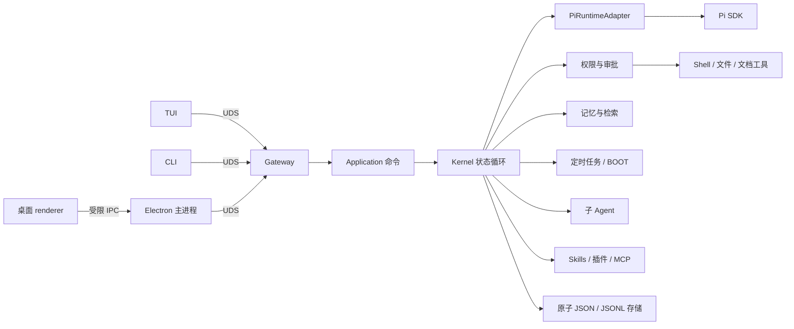

# pSpore 开发者指南

本文面向想了解实现、在本地开发或参与发布的读者。只想安装使用的话，请看[中文 README](../README.zh-CN.md)。

| 文档 | 内容 |
|---|---|
| [README.zh-CN.md](../README.zh-CN.md) / [README.md](../README.md) | 安装、配置与日常使用 |
| 本文 | 架构一览、目录结构、开发命令、测试与发布 |
| [detailed-design.md](detailed-design.md) | 完整详细设计与 v1 验收契约 |
| [ADR 0001](adr/0001-runtime-and-pi-baseline.md) | Node 24、Pi `v0.84.1`、Electron 43 的版本决策 |
| [initial_design.txt](../initial_design.txt) | 最初的 11 条设计想法（不是最终契约） |

## 项目状态

功能 v1 已完成：Phase 0—4 的 Node/Pi 契约、Kernel、私有存储、权限与审批、Shell、长期记忆（精确搜索 + BM25）、cron/BOOT、可持久的执行记录、双工子 Agent 树、按需 MCP、受信资源生命周期、UDS Daemon、CLI、可重连 TUI，以及安全加固的 Electron 43 桌面客户端均已落地。

- 运行时基线：Node.js 24，Pi 精确锁定 `v0.84.1`，桌面端 Electron `43.3.0`。
- TUI 与桌面端同时连接同一个权威 Daemon；桌面 renderer 不拥有 Node 或文件系统权限。
- v1 之后不主动扩展 sandbox 执行器、向量检索、远程传输、移动端或插件市场；这些需要先提出明确需求，再重新评估边界。

## 架构一览



- **Daemon 是唯一的状态写入者**。它持有 Pi 会话、调度器、MCP 连接和事件序号；生产环境作为 systemd 用户服务运行，关闭任何客户端都不会停止它。
- **客户端都是可重连的外壳**。TUI 和 CLI 直接连接 `~/.pspore/run/` 下权限为 `0600` 的 Unix domain socket；桌面端由 Electron 主进程独占这条连接，renderer 只能通过 preload 暴露的固定 API 收发消息。
- **Pi 只有一个入口**：`src/pi/pi-runtime-adapter.ts`。其他模块只使用 pSpore 自己的领域类型，Pi 升级的影响由 contract 测试约束。
- **依赖方向固定**：UI / adapter → application → kernel。`kernel/` 不导入子进程、Electron、DOM、TUI、MCP SDK 或具体模型 provider。

## 安全边界

- Linux-first、local-first、单用户；不提供多租户或公网服务。
- 主进程与工具使用启动 pSpore 的登录用户权限，**不是沙箱**。`allow_all` 等于授权模型以当前用户身份执行任意操作；若用户有免密或已缓存的 `sudo`，影响可能扩大到 root。
- Pi 扩展、Host 插件和本地 MCP 服务都可能执行任意代码，只有在显式信任后才加载。用户放进 `workspace/skills/` 的 Skill 视为已信任；模型用 `edit` 改写该目录需要审批（`ask_risky` 下），但 Shell 命令仍可绕过这项识别。
- 桌面 renderer 使用严格 CSP、`contextIsolation` 与 `sandbox`，关闭 Node integration、外部导航、新窗口、下载和网络请求。拖入文件只记录路径；点击回复里的本地路径时，由主进程检查路径存在且不是可执行文件后，再交给系统打开。
- 密钥与代理 Cookie 只保存在 `~/.pspore/credentials/` 下的 `0600` 文件中，不写入 `config.json`、会话或日志。

## 目录结构

| 路径 | 用途 |
|---|---|
| `src/cli/` | `p-spore` / `pspore` 命令入口（`main.ts`） |
| `src/daemon/` | Daemon 组装、启停与资源清理；`supervisor.ts` 供测试管理隔离 Daemon |
| `src/service/` | systemd 用户服务的安装、状态、重启和启动规格 |
| `src/application/` | UDS 命令用例，按会话串行执行 |
| `src/kernel/` | 纯 reducer、权威状态与串行 effect 循环 |
| `src/pi/` | Pi SDK 适配边界、上下文预算与工具输出摘录 |
| `src/protocol/`、`src/gateway/` | v1 消息信封、严格解码、UDS 客户端/服务端、幂等与重放 |
| `src/policy/`、`src/shell/` | 权限与审批、Shell/PTY 执行与密钥脱敏 |
| `src/tools/`、`src/documents/` | 内置 read/document/edit/search/shell 工具；Office、PDF 与文本抽取 |
| `src/memory/`、`src/indexing/` | 固定记忆、精确搜索、BM25；可选的本机索引服务 |
| `src/automation/`、`src/agents/` | cron、BOOT 与执行记录；子 Agent 树、邮箱与预算 |
| `src/mcp/`、`src/plugins/` | 按需 MCP；Skills、Host 插件与受信资源生命周期 |
| `src/articles/` | 长文文稿：版本、段落 diff、预览节流与导出转换 |
| `src/settings/`、`src/storage/`、`src/sessions/` | 模型设置；home 初始化与原子写入；会话目录与 JSONL 路径 |
| `src/ui/shared/`、`src/ui/tui/` | GUI/TUI 共用的协议归并与 Markdown；TUI 客户端 |
| `src/desktop/` | Electron 主进程、preload、renderer（`renderer/`）与视觉 smoke |
| `src/desktop/native/` | Electron 之前显示 loading 的 GTK3 原生启动器 |
| `bundled-skills/` | 随发行版附带的 Skills |
| `test/unit/`、`test/contract/`、`test/integration/` | 单元测试、Pi 契约测试、跨进程集成测试 |
| `scripts/` | 构建、打包、发布、Electron smoke 与 README 截图脚本 |
| `dist/` | 构建产物，**纳入 Git**：改动源码后必须 `npm run build` 并一起提交 |

## 开发环境

需要 Node.js 24、npm，以及 Linux（Daemon、Shell 和桌面验收都依赖 Linux）。依赖版本由 `package-lock.json` 锁定。中国大陆网络可以临时使用镜像，但不要写入全局 npm 配置：

```bash
npm install
# Electron 二进制下载慢时：
ELECTRON_MIRROR=https://npmmirror.com/mirrors/electron/ node node_modules/electron/install.js
```

常用命令：

| 命令 | 作用 |
|---|---|
| `npm run typecheck` | 严格类型检查 |
| `npm test` | 单元、契约与集成测试 |
| `npm run build` | 清理并重新生成 `dist/`，同步桌面静态资源 |
| `npm run check` | 以上三项，提交前必跑 |
| `npm run dev -- <命令>` | 直接从源码运行 CLI，例如 `npm run dev -- doctor` |
| `npm run desktop` | 构建并启动桌面客户端 |
| `node dist/cli/main.js <命令>` | 运行已构建的 CLI |

从源码运行时，`init` 创建数据目录，`daemon` 在前台启动服务（用于诊断），其余命令与 README 中的用法相同：

```bash
node dist/cli/main.js init
node dist/cli/main.js daemon      # 另开一个终端执行下面的命令
node dist/cli/main.js status
node dist/cli/main.js tui
```

Daemon 在未配置模型时也会 ready，方便检查健康状态；第一次提交任务时会明确返回 `model_not_configured`。开发时可以用 `--home 路径` 或 `PSPORE_HOME` 指向临时目录，避免影响自己的 `~/.pspore`。

## 测试与验收

### 自动化测试

- **单元测试**（`test/unit/`）：纯逻辑，包括 Markdown 解析、虚拟列表、会话搜索、渲染器模块图（禁止 renderer 触达 Node 内置模块）等。
- **契约测试**（`test/contract/`）：使用 Pi 官方 `fauxProvider`，不调用付费模型，覆盖流式事件、会话替换、JSONL 恢复、工具权限闸门、中止和上下文压缩。
- **集成测试**（`test/integration/`）：真实 HTTP/SSE → Pi → Daemon → UDS → DesktopStore 的完整链路，例如长工具循环中的自动压缩与重启恢复。

### 桌面端验收

PC 桌面的主视觉基准是 **1920 × 1080**，另外补测 `1440 × 900` 与 `1180 × 720`。

```bash
npm run test:electron          # 需要 xvfb-run
npm run test:article-stream    # 文稿面板在慢机条件下的流式验收
```

`test:electron` 会构建最新代码、创建临时 home，验证外部 Daemon 与桌面自带 Daemon 两条路径、重连、IPC allowlist、renderer 权限隔离、深浅主题、设置弹层、字号下限、响应式布局、文件拖拽只形成路径引用、长内容溢出、流式输出、审批弹层，以及工具过程的展开/折叠和超长输入。长历史 fixture 有 1007 条消息，并断言实际 DOM 少于 40 条。设置 `PSPORE_KEEP_SMOKE=1` 可以保留截图和 JSON 探针。

需要一个持续运行的隔离预览时（不安装系统服务）：

```bash
npm run build
PSPORE_SMOKE_KEEP_OPEN=1 npx electron dist/desktop/main.js \
  --home /tmp/pspore-preview --smoke-dir /tmp/pspore-preview-shots --smoke-fixture
```

### README 截图

`docs/images/` 中的截图都由脚本从真实应用生成。脚本先启动一个本地的、按剧本应答的 OpenAI 兼容“演示模型”（`scripts/readme-demo.mjs`），再在隔离 home 中跑一次真实的工具调用。整个过程不需要真实凭据，也不会读取个人文件。

```bash
npm run build
node scripts/readme-screenshots.mjs --lang en      # desktop-*.png，英文 README 使用
node scripts/readme-screenshots.mjs --lang zh-CN   # desktop-*.zh-CN.png，中文 README 使用
node scripts/readme-tui-screenshot.mjs             # tui.png，160×45 的 xterm（需要 xterm、xdotool、ImageMagick）
```

容器或 root 环境运行桌面截图时加 `PSPORE_ELECTRON_NO_SANDBOX=1`。英文截图会额外检查：除语言切换按钮外，界面里不能残留中文。公开截图只能使用演示数据，不能包含凭据或个人内容。

## 界面语言

桌面端支持简体中文和英文：默认跟随系统语言，顶栏的 **EN / 中** 按钮可以切换，选择保存在窗口本地，切换时界面重新载入。TUI 的界面文字是英文。

- 代码里的界面文字直接写中文，并通过 `t("…")`（渲染层，`src/desktop/renderer/i18n.ts`）或 `mt("…")`（主进程，`src/desktop/main-i18n.ts`）输出；英文写在 `src/desktop/renderer/messages-en.ts` 和 `MAIN_EN_MESSAGES` 里，以中文原文为键，用 `{name}` 表示参数。
- `index.html` 中的静态文字按原文自动翻译；同一中文需要不同英文时，用 `data-i18n="原文#上下文"` 区分。
- 窗口每次启动都会把当前语言报告给主进程，对话框标题和主进程返回的提示随之切换；Electron 启动小窗沿用上一次的语言。原生 GTK 启动窗暂时只有中文。
- `test/unit/desktop-i18n.test.ts` 会检查：每条界面中文都有英文翻译，英文里没有残留中文，占位符一致，渲染层没有绕过 `t()` 的中文。Electron smoke 固定以 `--lang=zh-CN` 运行，因为其中的断言读的是中文界面。

## 打包与发布

### 桌面发行包

- `npm run package:desktop` 按当前 Node 原生架构生成完整 ZIP、overlay 升级 ZIP、独立 CLI（Node SEA）以及各自的 SHA-256；产物在 `release-dist/`，不纳入 Git。ARM64 需要在原生 ARM64 + Node 24 环境中执行 `bash scripts/package-desktop.sh <version> arm64`。
- 发行包的体积由 `electron-builder.yml` 的 `files` 排除规则统一控制。
- 原生启动器（`src/desktop/native/startup.c`）先用 GTK3 显示 loading 再启动 Electron，加载失败时回退到 Electron 自身的 loading。为了兼容旧系统，x64/ARM64 都在 Ubuntu 20.04 工具链中构建，打包时检查 GLIBC 符号要求不高于 2.17：

  ```bash
  npm run build
  bash scripts/build-native-startup-container.sh /tmp/pspore-startup   # 需要 Docker
  PSPORE_NATIVE_STARTUP_BINARY=/tmp/pspore-startup npm run package:desktop
  ```

- ARM64 包由 `Package Linux ARM64` 工作流在原生 ARM runner 的 Ubuntu 20.04 容器中构建，与银河麒麟 V10 SP1 相同的 glibc 2.31 下完成完整测试和 1920 × 1080 桌面 smoke。

### 发布流程

1. 同步提升 `package.json`、`package-lock.json` 根版本与 `src/version.ts`，运行 `npm run check`，并确认 `git diff --exit-code -- dist` 无差异。
2. 推送 `main`。CI 通过且同一提交的 ARM64 预览成功后，`release` job 会创建 annotated tag `v<版本>` 并触发 `Release desktop`：x64 与 ARM64 资产先进入草稿 Release，逐项校验 SHA-256 与架构后再公开。仓库变量 `AUTO_RELEASE=false` 可以关闭自动发布。
3. **每次更新都要同步发布 npm 包 `p-spore`**：只从已跟踪、已验证的 `dist/`、`package.json`、`README.md`、`LICENSE` 生成 tarball，在仓库外的全新 prefix 安装验证后再发布；发布后核对 registry 的版本、`latest` 和校验值，并从 registry 重新安装复验。npm 登录和 2FA 通过浏览器完成，不在命令行传递 token。
4. 已发布的版本和 tag 不可覆盖；任何用户可见的变化都使用新的 SemVer 版本。

升级用户可以直接运行 overlay 包里的 `覆盖升级.sh`：它校验 Electron 精确版本、平台、架构和完整应用 payload，保留回滚备份并重启匹配的服务；运行时不匹配时拒绝升级并提示使用完整包。
